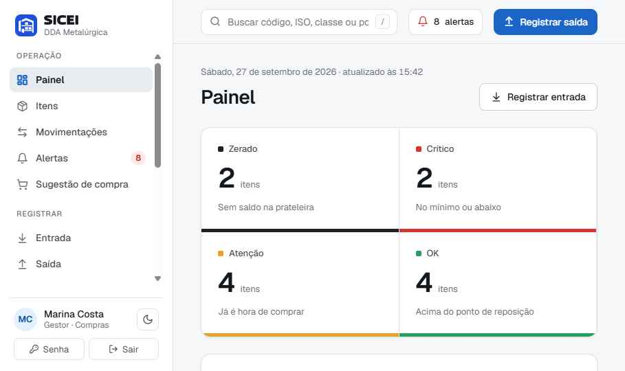
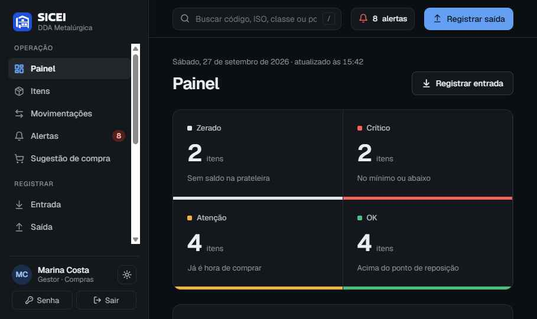
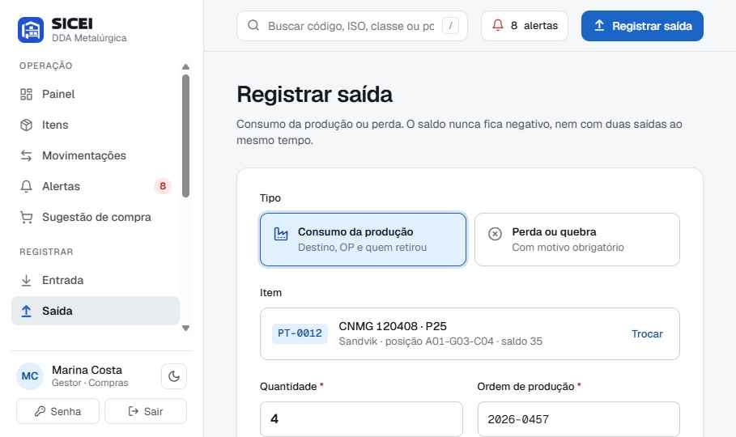
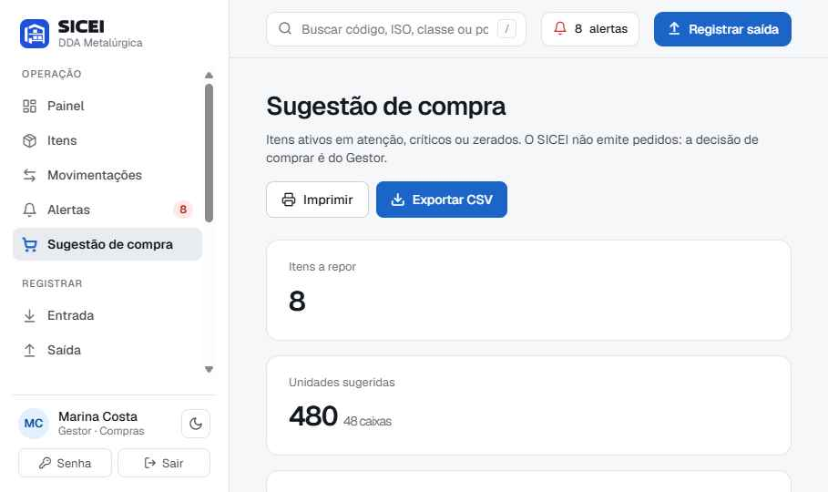
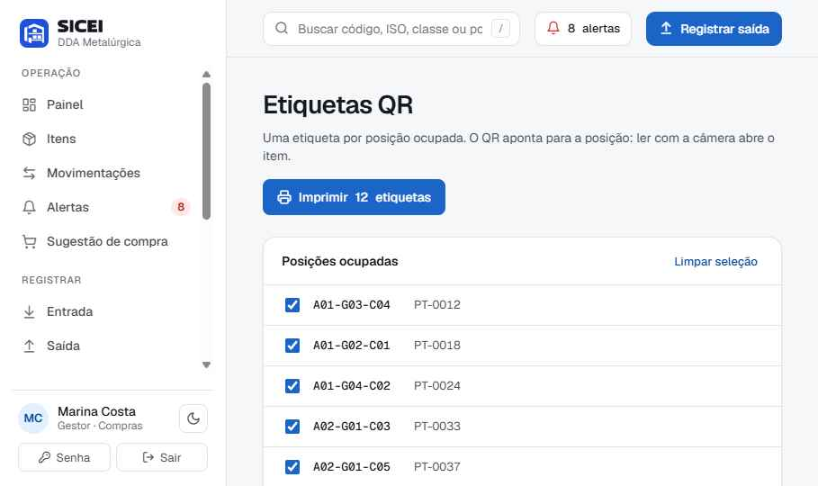
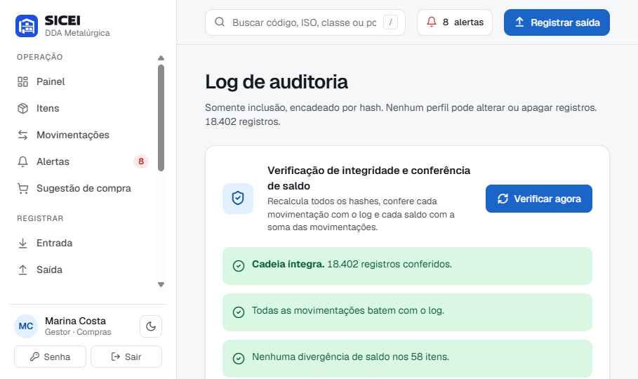
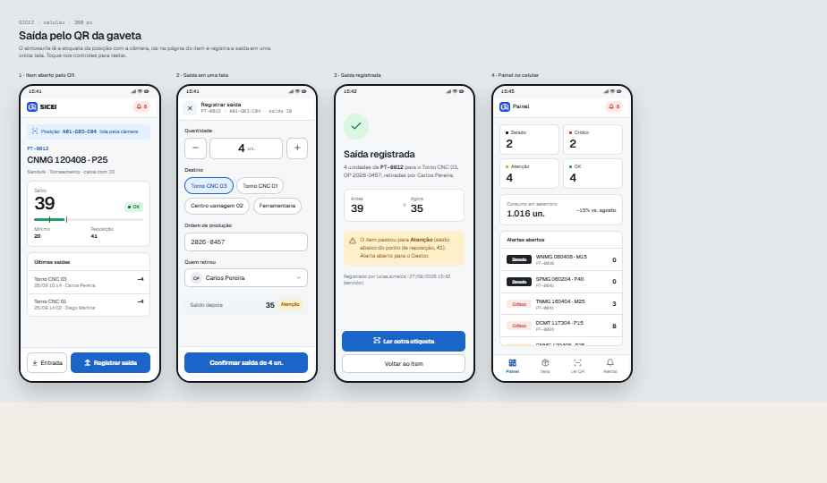
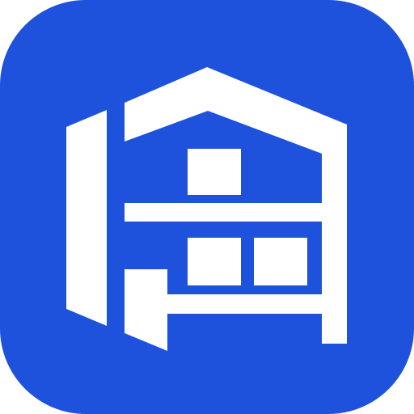

<div align="center">

<picture>
  <source media="(prefers-color-scheme: dark)" srcset="docs/brand/sicei-logo-dark.svg">
  
</picture>

# 🏭 SICEI: estoque de pastilhas de usinagem sob controle

**Quanto tem, onde está, quem tirou, para qual máquina e quando é hora de comprar.**<br>
**Saldo sempre certo, auditoria à prova de adulteração e QR na gaveta para o almoxarife.**

[](https://github.com/rafaelbenevidess/SICEI/actions/workflows/ci.yml)
[](https://nextjs.org)
[](https://react.dev)
[](https://www.typescriptlang.org)
[](https://www.postgresql.org)
[](https://www.prisma.io)
[](https://tailwindcss.com)<br>
[](#-testes)
[](https://sicei-ddausinagem.vercel.app/relatorio-testes/index.html)
[](https://sicei-ddausinagem.vercel.app)
[](https://neon.tech)
[](LICENSE)

[**🌐 Sistema no ar**](https://sicei-ddausinagem.vercel.app) · [**🧪 Laboratório de testes**](https://sicei-ddausinagem.vercel.app/testes) · [**📊 Relatório da suíte**](https://sicei-ddausinagem.vercel.app/relatorio-testes/index.html) · [**📚 Documentação**](#-documentação) · [**🤖 Uso de IA**](#-uso-de-ia-e-autoria)

</div>

---

> ### 🎓 Trabalho acadêmico com cliente real
>
> O SICEI é o trabalho acadêmico de Rafael Benevides, feito a partir da demanda real da
> **DDA Metalúrgica** (Santa Catarina), primeira empresa a usar o sistema.
>
> **Professor:** em [/testes](https://sicei-ddausinagem.vercel.app/testes) os testes das regras
> rodam no seu navegador, sem instalar nada, e dá para criar casos novos. O relatório completo,
> com a cobertura, fica em [/relatorio-testes](https://sicei-ddausinagem.vercel.app/relatorio-testes/index.html).
> O build só publica uma versão se todos os testes passarem.

---

## 🧩 O problema

A DDA controla as pastilhas em planilhas preenchidas à mão. Entrada e saída às vezes não são lançadas, ou entram atrasadas, e ninguém sabe ao certo quanto tem na gaveta. A compra acontece quando alguém percebe que acabou, e aí a máquina já parou.

## ✨ O que o sistema faz

- 📦 **Saldo em tempo real.** Cada pastilha com status (OK, Atenção, Crítico, Zerado) e a posição exata no almoxarifado: armário, gaveta e compartimento.
- 🔁 **Todas as movimentações.** Entrada por compra (com nota fiscal e preço), saída para a produção (com destino, ordem de produção e quem retirou), devolução, perda, inventário e estorno. O saldo nunca fica negativo, nem com duas saídas ao mesmo tempo.
- 🏷️ **Fornecedores e preços.** Todos os fornecedores de cada item, com o último preço de cada um e o histórico.
- 🔔 **Reposição.** Aviso no painel e por e-mail quando um item chega ao ponto de reposição, com sugestão de quanto comprar. Ao entrar, Gestor e Administrador veem um pop-up com os alertas ainda sem ciente.
- 📈 **Relatórios e Análise.** Consumo, movimentação e reposição, com CSV e PDF. A página de Análise combina período, itens, destinos, colaboradores, aplicações e fabricantes, compara lado a lado e traz gráficos interativos: evolução, ranking com foco pelo clique, horários de retirada, entradas e saídas.
- 📱 **QR na gaveta.** Etiquetas QR impressas pelo sistema. A tela "Ler QR" abre a câmera de qualquer celular (Android ou iPhone) dentro do SICEI, lê a etiqueta, abre o item e registra a saída numa tela só.
- 🔎 **Busca tolerante.** "pst1", "Pst 001" e "PST-1" são o PST-001; "a1g3c4" é a posição A01-G03-C04; o CNPJ pode ir só com números. Vale na busca do topo, nas listas, nos filtros, no Ler QR e na importação. O código de item novo entra no padrão da sequência, e o mesmo código escrito de outro jeito é recusado.
- 🌗 **Tema claro e escuro**, com telas pensadas para o celular do almoxarife e para o computador do escritório.
- 👥 **Usuários sem e-mail.** Nome, sobrenome e matrícula: o sistema gera o login e a senha provisória, e cada matrícula tem um login só. O Administrador principal não pode ser inativado, rebaixado nem ter a senha trocada por outra conta, e só ele cuida de outros Administradores.
- 🔐 **Auditoria encadeada por hash.** Cada operação vai para um log em que uma verificação aponta qualquer registro adulterado, e o banco recusa alteração e exclusão do histórico.

---

## 🖥️ As telas

<table>
  <tr>
    <td width="50%"><br><sub><b>Painel</b>: itens zerados, críticos, em atenção e OK</sub></td>
    <td width="50%"><br><sub><b>Tema escuro</b></sub></td>
  </tr>
  <tr>
    <td><br><sub><b>Registrar saída</b>: destino, ordem de produção e quem retirou</sub></td>
    <td><br><sub><b>Sugestão de compra</b> a partir do ponto de reposição</sub></td>
  </tr>
  <tr>
    <td><br><sub><b>Etiquetas QR</b> para as gavetas</sub></td>
    <td><br><sub><b>Auditoria</b> com a cadeia de hash verificada</sub></td>
  </tr>
  <tr>
    <td colspan="2"><br><sub><b>No celular</b>: item aberto pelo QR, saída em uma tela e painel</sub></td>
  </tr>
</table>

<sub>Imagens do protótipo entregue pelo autor em <code>design_handoff_sicei/</code>, que a interface implementa.</sub>

---

## 🛡️ Regras que o sistema não deixa quebrar

| Regra | Como é garantida |
|---|---|
| Saldo nunca fica negativo (RN-08) | `SELECT ... FOR UPDATE` na linha do item dentro da transação, e `CHECK (saldo >= 0)` no banco como última defesa |
| O saldo vem das movimentações (RN-06) | Ninguém edita saldo direto |
| Movimentação e auditoria são imutáveis (RN-09a, RN-12) | Sem UPDATE nem DELETE no código, e triggers no banco recusando os dois. Erro se corrige com estorno |
| Nada com histórico é apagado (RN-02) | Só inativação |
| Rastreabilidade total (RN-09, RN-23) | Usuário, data e hora do servidor, IP e dispositivo em toda escrita, com registro no `audit_log` na mesma transação |
| Login sem e-mail (RN-21) | Login `nome.sobrenome` gerado pelo sistema e troca de senha obrigatória no primeiro acesso |

As 26 regras estão no [doc 01](docs/01-regras-de-negocio.md).

---

## 🧱 Stack

| Camada | Escolha |
|---|---|
| **Aplicação** | Next.js 16 (App Router, Server Actions) + React 19 + TypeScript estrito |
| **Estilo** | Tailwind 4, fonte Geist, ícones Lucide |
| **Banco** | PostgreSQL 17 com Prisma 7 (adapter `pg`) |
| **Validação** | Zod em toda entrada, no servidor |
| **Senhas** | Argon2id (`@node-rs/argon2`) |
| **QR** | `qrcode` para gerar, `jsqr` para ler pela câmera |
| **E-mail** | Nodemailer, para os alertas de reposição |
| **Testes** | Vitest, Testing Library e Playwright |
| **Hospedagem** | Vercel (região São Paulo) e Neon, com CI no GitHub Actions |

As escolhas e as alternativas descartadas estão no [doc 03](docs/03-system-design.md).

### Arquitetura

```
src/
├── domain/              # regras puras, sem banco nem Next: rodam no Node e no navegador
├── server/
│   ├── services/        # casos de uso: permissão → Zod → transação → decisão → gravação → auditoria
│   └── consultas/       # leitura do banco
├── app/                 # telas e Server Actions finas (conferem a sessão e chamam o service)
├── components/          # componentes React
├── lab/                 # Laboratório de testes que roda no navegador (/testes)
└── lib/                 # utilidades e dados do produto
prisma/                  # schema e migrations (com os triggers de imutabilidade)
tests/
├── integracao/          # serviços contra PostgreSQL real
└── e2e/                 # Playwright no celular (360 px) e no computador (1366 px)
```

---

## 🧪 Testes

| Tipo | Quantidade | O que cobre |
|---|---|---|
| 🧱 Unitários | 950 | Regras de negócio, validações, telas e componentes (99% das linhas em `src/domain/`) |
| 🗄️ Integração | 107 | Serviços contra PostgreSQL real: concorrência, estorno, triggers, permissões, cadeia de hash, filtros de busca |
| 🌐 Ponta a ponta | 21 | Fluxos no navegador, no celular e no computador: troca de senha, leitura do QR pela câmera, saída pela etiqueta, estorno, usuários, compra com fornecedor novo, parâmetros, importação, CSV, análise personalizada |

```bash
npm test                  # unitários
npm run test:integracao   # integração (precisa de PostgreSQL)
npm run test:e2e          # ponta a ponta (rode npm run build:app antes)
```

Os casos de teste das regras são dados, num arquivo `*.casos.ts` ao lado de cada módulo. O mesmo arquivo alimenta o Vitest e o [Laboratório](https://sicei-ddausinagem.vercel.app/testes) que roda no navegador.

---

## ⚡ Como rodar

```bash
cp .env.example .env          # preencha as URLs do banco
npm install
npm run db:migrate
SEED_DEMO=1 npm run db:seed   # mostra a senha provisória do admin
npm run dev
```

Antes de cada commit: `npm run lint && npm run typecheck && npm test`. Os usuários do banco, a publicação e o backup estão no [doc 06](docs/06-operacao.md).

### 🏢 Uma instalação por empresa

Cada empresa que licencia o SICEI recebe uma instalação separada, sem nada em comum com as outras: projeto próprio na Vercel e no Neon, endereço `sicei-<empresa>.vercel.app` e banco `sicei_<sigla>`. O código é o mesmo. O nome da empresa no login e no rodapé vem da variável `SICEI_LICENCIADA`. O passo a passo está no doc 06, seção 5, e a decisão está no doc 03 (ADR-12).

---

## 📚 Documentação

| # | Documento | Versão |
|---|---|---|
| 01 | [Regras de negócio](docs/01-regras-de-negocio.md) | 1.7 |
| 02 | [Requisitos](docs/02-requisitos.md) | 1.17 |
| 03 | [System design e stack](docs/03-system-design.md) | 1.22 |
| 04 | [Segurança](docs/04-seguranca.md) | 1.6 |
| 05 | [Plano de testes e QA](docs/05-plano-de-testes.md) | 1.15 |
| 06 | [Operação](docs/06-operacao.md) | 1.3 |

As regras de trabalho do projeto (arquitetura, testes, segurança, convenções) estão em [CLAUDE.md](CLAUDE.md).

O Documento do Sistema entregue na UC Projeto Aplicado IV (DOCX e PDF no template da disciplina, com DER e diagramas UML em SVG) está em [docs/entrega-pa4](docs/entrega-pa4). Os diagramas são escritos em PlantUML (`diagramas/*.puml`, gerados por `diagramas/gerar.sh`) e o documento é montado por `fonte/montar_documento.py`.

---

## 🤖 Uso de IA e autoria

Este projeto foi feito com o Claude Code, assistente de programação da Anthropic. Os commits feitos pelo assistente trazem a linha `Co-Authored-By: Claude`. O autor definiu o que o sistema faz, aprovou cada etapa antes da seguinte, testou o sistema publicado e pediu as correções listadas abaixo. O assistente escreveu os documentos, o código e os testes a partir dessas decisões.

### Decisões do autor

- O problema, o escopo e as regras de negócio: vários fornecedores por item com histórico de preços, rastreabilidade total de cada movimentação, retenção de 7 anos, controle só por quantidade, nota fiscal obrigatória.
- As respostas às dúvidas de negócio levantadas nos requisitos: controle por unidade, localização exata de cada pastilha, saída com destino, ordem de produção e quem retirou, 10 a 30 usuários, etiqueta QR gerada pelo sistema, aviso por e-mail, importação da planilha atual, perfil Consulta sem ver preços.
- Tirar do escopo a API pública e a integração com ERP (RF-23 e RF-24), por ser um trabalho acadêmico.
- Login sem e-mail: o Administrador informa nome e sobrenome, o sistema gera o login e uma senha provisória, trocada no primeiro acesso.
- Endereçamento em três níveis (armário, gaveta, compartimento).
- Stack Next.js com PostgreSQL, publicação na Vercel e no Neon.
- Testes unitários em todo o sistema, publicados na web para o professor executar e criar os próprios casos.
- O nome SICEI (o projeto começou como SIMI) e o SICEI como produto próprio, licenciado por empresa, com uma instalação para cada cliente.
- O design da interface: as telas, o tema escuro, a versão de celular e a marca, entregues como protótipo em `design_handoff_sicei/`.

<details>
<summary><b>Correções e pedidos do autor, na ordem em que vieram</b></summary>

#### Planejamento

- Fez o assistente voltar ao começo: primeiro as regras de negócio e os requisitos, depois o system design.
- Pediu que os testes unitários fossem visíveis na web e, em seguida, que todo o sistema tivesse teste unitário onde fosse possível. Daí saíram o Laboratório de testes (`/testes`) e os casos de teste escritos como dados.

#### Publicação e identidade

- Apontou o erro de tipos do `@testing-library/jest-dom/vitest` no ambiente local, corrigido na configuração.
- Pediu uma explicação mais clara sobre o usuário do banco usado em produção. O texto foi reescrito no doc 06: a aplicação usa um usuário sem permissão de alterar movimentações e o log.
- Renomeou o projeto para SICEI, pediu um titular fictício, trocou o endereço para `sicei-ddametalurgica.vercel.app` e depois para `sicei-ddausinagem.vercel.app`, e renomeou os usuários do banco. Clonou o repositório e publicou com os próprios commits.
- Pediu um README com logo, badges e telas, no estilo de outro projeto dele.

#### Interface

- Pediu a implementação do design que criou.
- Leitura do QR pela câmera de qualquer celular, dentro do SICEI, em vez de depender da câmera nativa.
- Cadastro de fabricante e fornecedor na hora de criar um item, com o próximo código interno já sugerido; aba Itens em Cadastros; aviso de etiqueta não impressa ao mudar o item de posição; filtro de ação da auditoria em lista.
- Questionou o IP gravado na auditoria. A resposta: um sistema web só recebe o IP público da rede, igual para todos os computadores atrás do mesmo roteador; o doc 04 explica isso e o aparelho fica identificado pelo login e pelo navegador.
- Pop-up de alertas sem ciente ao entrar. Depois corrigiu o comportamento: aparece só no login, obriga a clicar em VER e ir aos alertas, mas não obriga a dar ciente, que é de quem responde pelo item.
- Autocompletar e código padronizado ao registrar entrada e saída, e depois a mesma busca tolerante em todos os campos em que ela cabe.
- Ícone nítido e o nome SICEI escrito com a fonte, não recortado de imagem; logo da DDA sem fundo, centralizada no login; "DDA USINAGEM INDUSTRIAL" no menu, alinhado ao ícone.

#### Segurança

- Propôs que nenhum outro Administrador pudesse remover o Administrador principal, para um funcionário mal-intencionado não sequestrar o sistema, e pediu uma revisão de segurança. Virou a RN-21c, protegida no código e no banco, e as outras falhas encontradas estão no doc 04.
- Pediu edição do nome dos funcionários (vinham em caixa alta) e matrícula obrigatória e única, para cada funcionário ter um login só. Apontou tabelas com rolagem lateral mesmo com espaço na tela, corrigidas em todas as telas.

#### Relatórios e análise

- Pediu gráficos no estilo Power BI para acompanhar o consumo, sem perder a visão rápida dos relatórios.
- Pediu para escolher um ou vários itens e, em seguida, que a Análise virasse uma página própria em Gestão, com filtros combináveis.
- Notou que, com mais de 4 itens, os demais ficavam cinza nos gráficos. A paleta passou a ter 8 cores validadas para daltonismo.
- Imprimiu a Análise em PDF e mostrou que as barras, o mapa de calor e parte do gráfico de entradas e saídas não saíam. A impressão passou a manter as cores, a usar sempre o tema claro e a ajustar os gráficos à largura da folha.

</details>

### Feito pelo assistente

A redação dos documentos, o código (incluindo a implementação do design do autor), os testes, a integração contínua, a publicação e as revisões de código e de segurança, sempre a partir das decisões e correções acima.

### Como o autor acompanhou

Aprovou cada etapa (regras, requisitos, system design) antes de a próxima começar, respondeu às dúvidas de negócio, testou cada entrega no sistema publicado, no computador e no celular, e devolveu com prints e PDFs o que precisava mudar.

---

## ⚖️ Propriedade e licença

O SICEI é propriedade da **Benevides Soluções Industriais**. Todos os direitos reservados. A DDA Metalúrgica usa o sistema sob licença e não é dona do código. Os termos estão em [LICENSE](LICENSE).

📬 Contato comercial: comercial@sicei.exemplo.com.br

<sub>O nome do titular e o contato ainda são fictícios. Para trocar, edite <code>src/lib/produto.ts</code> (rodapé do sistema), este README, o <code>LICENSE</code> e o campo <code>author</code> do <code>package.json</code>.</sub>

<div align="center">
<br>

<br>
<sub>SICEI · Sistema Inteligente de Controle de Estoques Industriais</sub>
</div>
