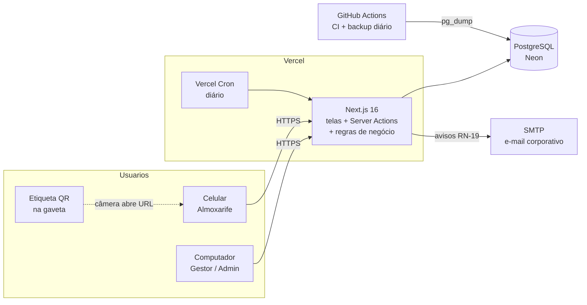
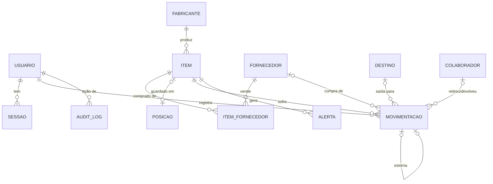
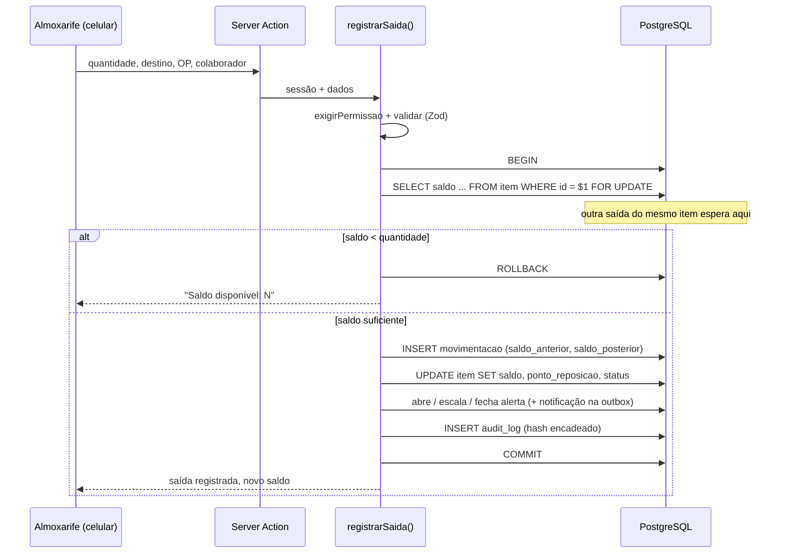

# SICEI: System Design

| | |
|---|---|
| **Projeto** | SICEI (Sistema Inteligente de Controle de Estoques Industriais), controle de estoque de pastilhas industriais |
| **Documento** | 03, System Design e Stack |
| **Versão** | 1.12 (para revisão) |
| **Base** | [01, Regras de Negócio](01-regras-de-negocio.md) · [02, Requisitos](02-requisitos.md) |

Este documento explica **como** o SICEI vai ser construído para cumprir as regras e os requisitos. Cada decisão aponta para a regra ou o requisito que ela atende. As decisões principais estão resumidas como ADRs na seção 11.

## 1. Visão geral

O SICEI é uma aplicação web responsiva, usada no computador do escritório e no celular do almoxarife. É um **monólito modular**: um único projeto Next.js serve as telas e executa as regras de negócio no servidor, com um banco PostgreSQL por trás.

Com 10 a 30 usuários e alguns milhares de itens, não há motivo para separar front e back, usar microsserviços ou filas externas. Um projeto só é mais barato de hospedar, mais fácil de testar e mais simples de manter, que é o que pede o RNF-07.



## 2. Stack

Versões conferidas em setembro de 2026, sempre na última versão estável.

| Camada | Escolha | Por quê |
|---|---|---|
| Linguagem | **TypeScript** (modo `strict`) | Uma linguagem no projeto todo. Os tipos pegam erros antes de rodar. |
| Framework | **Next.js 16** (App Router) + **React 19** | Telas e servidor no mesmo projeto. Server Components buscam dados direto no servidor e Server Actions recebem os formulários, então não é preciso manter uma API REST (que ficou fora do escopo). |
| Banco | **PostgreSQL 16+** | Transações ACID, `SELECT … FOR UPDATE`, `CHECK`, triggers e índices parciais, tudo usado nas regras críticas. |
| ORM | **Prisma ORM 7** com `@prisma/adapter-pg` e `prisma.config.ts` | Modelo tipado e migrations versionadas. O SQL puro (`$queryRaw`) entra nos pontos em que o ORM não alcança: lock de linha, triggers e permissões do banco. |
| Autenticação | **Sessão própria guardada no banco** + **Argon2id** (`@node-rs/argon2`) | O login não usa e-mail, e o sistema precisa derrubar sessões na hora em que alguém é inativado (RN-21b). Uma sessão em tabela resolve os dois com pouco código. |
| Validação | **Zod 4** | O mesmo schema valida o formulário no navegador e os dados no servidor. |
| Interface | **Tailwind CSS 4** com tokens próprios (tema claro e escuro), fonte **Geist** e ícones **lucide-react** | Os componentes são do próprio projeto (`components/ui.tsx` e `components/formulario.tsx`), feitos a partir do design do SICEI (seção 10). Sem biblioteca de componentes: menos dependências e controle total de acessibilidade. |
| Gráficos | Barras em HTML e CSS montadas no servidor | O painel (RF-16) só precisa do consumo diário do mês. Uma biblioteca de gráficos pesaria mais que a própria tela. |
| QR | **qrcode** (gerar) + leitor nativo do navegador ou **jsQR** (ler) | O `qrcode` gera o QR das etiquetas no servidor. Na tela "Ler QR", o navegador que tem leitor nativo (`BarcodeDetector`, Chrome no Android) usa o dele; os outros, como o Safari do iPhone, usam o jsQR, em JavaScript puro, baixado só quando precisa (RF-22, ADR-13). |
| CSV | **Papa Parse** | Leitura da planilha na importação (RF-25) e geração dos CSV exportados (RF-20). |
| PDF | Página de impressão com CSS `@media print` | Relatórios e etiquetas saem pelo "Imprimir → Salvar como PDF" do navegador, sem biblioteca nem serviço extra. |
| E-mail | **Nodemailer** (SMTP) | Funciona com qualquer e-mail corporativo. No desenvolvimento, o **Mailpit** captura os e-mails localmente. |
| Logs técnicos | JSON em uma linha na saída padrão | Logs estruturados de erro (RNF-11), separados do log de auditoria. A Vercel recolhe a saída padrão; não precisa de biblioteca. |
| Testes | **Vitest 5** (unidade e integração, com repórter HTML e Vitest UI) + **Playwright** (ponta a ponta) | Ver seção 9. Os testes das regras também rodam no navegador do avaliador (seção 9.3). |
| Qualidade | ESLint, Prettier, `tsc --noEmit`, GitHub Actions | Rodam em todo push. |
| Hospedagem | **Vercel** (plano Hobby) + **Neon** (PostgreSQL, plano Free) | Custo zero para um projeto acadêmico. |
| Execução local | **Docker Compose** (app, PostgreSQL, Mailpit) | Sobe o sistema inteiro com um comando, para desenvolver ou apresentar sem internet. |

## 3. Arquitetura em camadas

```
src/
├── app/                    rotas e telas (App Router)
│   ├── login, trocar-senha, sem-permissao   telas fora do menu
│   ├── (app)/painel, itens, movimentacoes, relatorios, alertas
│   ├── (app)/movimentacoes/nova/  registrar entrada ou saída (RF-07, RF-08)
│   ├── (app)/cadastros/    fabricantes, fornecedores, destinos, colaboradores, posicoes (em abas)
│   ├── (app)/admin/        usuarios, parametros, auditoria, importacao
│   ├── (app)/p/            "Ler QR" no celular; p/[codigo] é o destino do QR da etiqueta
│   ├── testes/             Laboratório de testes público (seção 9.3)
│   └── api/cron/           rotina diária (protegida por segredo)
├── components/             componentes de interface (ui.tsx, formulario.tsx, shell/)
├── lib/                    formatação, tema, resumo do log e outras funções puras de tela
├── domain/                 regras puras, sem banco e sem framework
│   ├── estoque.ts          consumo médio, ponto de reposição, status, sugestão (RN-15 a RN-20)
│   ├── movimentacao.ts     decisões de entrada, saída e estorno (RN-08, RN-10 a RN-13)
│   ├── alertas.ts          abrir / escalar / fechar alerta (RN-18, RN-19)
│   ├── precos.ts           último preço e histórico por fornecedor (RN-05a, RN-05b)
│   ├── posicao.ts          endereçamento (RN-25)
│   ├── auditoria.ts        hash encadeado e verificação (RN-09a)
│   ├── *.casos.ts          casos de teste como dados, usados pelo Vitest e pelo Laboratório
│   ├── login.ts            geração de login a partir do nome (RN-21)
│   ├── senha.ts            política de senha e geração da provisória (RN-21, RN-22)
│   ├── cnpj.ts             validação e máscara de CNPJ (RN-04)
│   ├── busca.ts            busca tolerante de itens e de opções de listas (RF-11)
│   ├── codigo.ts           próximo código, código equivalente e padronizado (RN-01)
│   ├── parametros.ts       limites dos parâmetros e histórico de alterações (RF-26)
│   ├── importacao.ts       validação e resumo das linhas do CSV (RF-25)
│   ├── permissoes.ts       matriz perfil × permissão (doc 02, seção 5)
│   └── schemas/            schemas Zod de cada formulário
├── server/
│   ├── services/           casos de uso: registrarSaida, estornar, criarUsuario...
│   ├── consultas/          leituras do banco para as telas (busca.ts: candidatos dos filtros de texto)
│   ├── auth/               sessão, hash de senha, bloqueio, rate limit
│   ├── audit/              gravação e verificação do log encadeado
│   ├── notificacao/        outbox de e-mail
│   └── db.ts               Prisma Client
├── proxy.ts                cabeçalhos de segurança e redirecionamento de quem não está logado
prisma/
├── schema.prisma
├── migrations/             inclui SQL de triggers, CHECKs e permissões
└── seed.ts                 Administrador inicial e parâmetros padrão
tests/
├── integracao/  e2e/       (os testes de unidade ficam ao lado de cada módulo, em *.test.ts)
```

**Regras de dependência:**

1. `domain/` não importa nada de `server/` nem de `app/`. São funções puras, fáceis de testar, e é onde ficam as fórmulas do documento 01.
2. As telas **nunca** acessam o banco diretamente. Leitura passa por `consultas/`, escrita passa por `services/`.
3. Todo service de escrita segue a mesma sequência:
   1. `exigirPermissao(usuario, 'movimentacao:saida')`, que confere o perfil no servidor (RNF-05);
   2. validação da entrada com Zod;
   3. abertura da transação;
   4. regra de negócio;
   5. gravação;
   6. registro no log de auditoria, dentro da mesma transação;
   7. commit.

   Se qualquer passo falhar, nada é gravado.
4. As Server Actions são finas: recebem o formulário, chamam o service e devolvem o resultado para a tela.

Seguindo o guia de segurança do Next.js, cada Server Action confere a sessão de novo, mesmo que a página já tenha conferido, porque toda Action é uma porta de entrada independente.

## 4. Modelo de dados



### Tabelas

| Tabela | Campos principais | Restrições importantes |
|---|---|---|
| `usuario` | id, nome, sobrenome, login, setor, perfil, ativo, deve_trocar_senha, senha_hash, falhas_login, bloqueado_em | `login` único e nunca reaproveitado |
| `historico_senha` | usuario_id, senha_hash, criado_em | guarda as 3 últimas (RN-22) |
| `sessao` | id (hash SHA-256 do token), usuario_id, expira_em, ultimo_uso, ip, user_agent | apagada no logout e na inativação |
| `tentativa_login` | ip, login_informado, sucesso, criado_em | usada no rate limit por IP |
| `fabricante` | id, nome, ativo | `lower(nome)` único |
| `fornecedor` | id, razao_social, nome_fantasia, cnpj, telefone, contato, ativo | `cnpj` único |
| `item` | id, codigo, descricao, iso, classe, cobertura, aplicacao, fabricante_id, embalagem, estoque_minimo, estoque_maximo, **saldo**, **ponto_reposicao**, **status**, ativo | `codigo` único; `CHECK (saldo >= 0)`; `CHECK (estoque_maximo IS NULL OR estoque_maximo > estoque_minimo)` |
| `item_fornecedor` | item_id, fornecedor_id, codigo_no_fornecedor, lead_time_dias, preferencial, ultimo_preco, data_ultima_compra | PK (item_id, fornecedor_id); índice único parcial para um preferencial por item |
| `posicao` | id, armario, gaveta, compartimento, codigo, item_id, ativo, etiqueta_pendente | `codigo` único (`A01-G03-C04`); `item_id` único quando preenchido; `etiqueta_pendente` fica true quando um item entra e volta a false quando a etiqueta é impressa (RN-26) |
| `destino` | id, tipo, codigo, nome, ativo | `codigo` único |
| `colaborador` | id, nome, matricula, setor, ativo | `matricula` única quando preenchida |
| `movimentacao` | id, item_id, tipo, quantidade, saldo_anterior, saldo_posterior, fornecedor_id, preco_unitario, nota_fiscal, destino_id, ordem_producao, colaborador_id, motivo, estorna_id, usuario_id, ip, user_agent, criado_em | `CHECK (quantidade > 0)`; `estorna_id` único; `CHECK`s por tipo (ex.: `COMPRA` exige fornecedor, preço e NF); **sem UPDATE nem DELETE** |
| `alerta` | id, item_id, nivel, aberto_em, fechado_em, ciente_por, ciente_em | índice único parcial `(item_id) WHERE fechado_em IS NULL` |
| `notificacao` | id, alerta_id, nivel, destinatario, status, tentativas, erro, criado_em, enviado_em | outbox de e-mail |
| `audit_log` | seq, acao, entidade, entidade_id, antes, depois (JSONB), usuario_id, ip, user_agent, criado_em, prev_hash, hash | **sem UPDATE nem DELETE** |
| `parametro` | chave, valor | janela de consumo, tempo de sessão, e-mail de aviso |

Algumas decisões do modelo:

- **IDs** são UUID v7, que são únicos e crescem com o tempo, o que ajuda nos índices. O `audit_log` usa uma sequência numérica (`seq`), porque a cadeia de hash precisa de uma ordem sem ambiguidade.
- **Datas** são `timestamptz`, gravadas em UTC e exibidas no fuso America/Sao_Paulo. A hora sempre vem do banco (`now()`), nunca do aparelho (RN-09).
- **O histórico de preços não tem tabela própria.** Ele é a lista das movimentações `COMPRA` de cada item + fornecedor. O `ultimo_preco` em `item_fornecedor` é só um atalho, recalculado a cada compra ou estorno de compra (RN-05a).
- **O saldo fica guardado em `item.saldo`**, atualizado na mesma transação da movimentação. Somar um milhão de linhas a cada consulta seria lento (RNF-03). A soma das movimentações continua sendo a fonte da verdade, e a conferência da RN-09b compara as duas.
- **`ponto_reposicao` e `status` também ficam guardados**, recalculados a cada movimentação do item e pela rotina diária.
- **Preços** são `numeric(12,2)`, nunca ponto flutuante.
- **Índices** para os filtros de histórico e relatórios: `movimentacao (item_id, criado_em)`, `(tipo, criado_em)`, `(destino_id, criado_em)`, `(colaborador_id, criado_em)` e `(ordem_producao)`.

## 5. Fluxos críticos

### 5.1 Saída sem saldo negativo (RN-08)

Duas pessoas podem tentar tirar o mesmo item no mesmo segundo. O lock de linha faz a segunda esperar a primeira terminar e só então conferir o saldo.



O `CHECK (saldo >= 0)` fica como última defesa: mesmo que um bug passe pelo código, o banco recusa o saldo negativo. As entradas, os ajustes e os estornos usam o mesmo caminho, com o mesmo lock.

### 5.2 Log que não pode ser alterado (RN-09a)

Três camadas de proteção:

1. **Permissão no banco.** A aplicação se conecta com um usuário (`sicei_<empresa>_app`) que só tem `SELECT` e `INSERT` em `movimentacao` e `audit_log`. Mesmo que alguém invada a aplicação, não consegue alterar o histórico. As migrations rodam com outro usuário (`sicei_<empresa>_owner`).
2. **Trigger.** `BEFORE UPDATE OR DELETE` nessas duas tabelas dispara um erro, o que protege também contra engano de quem tem acesso de dono.
3. **Cadeia de hash.** Cada registro do `audit_log` guarda:

   ```
   hash = SHA-256( prev_hash || seq || JSON canônico do registro )
   ```

   O primeiro registro usa um `prev_hash` de 64 zeros. Para dois registros não disputarem o mesmo "anterior", a gravação pega um lock de transação (`pg_advisory_xact_lock`), o que não pesa com 30 usuários. Cada movimentação gera um registro de auditoria com todos os seus campos.

A **verificação de integridade** (RF-21) percorre o `audit_log` em ordem, recalcula cada hash e aponta o primeiro `seq` em que a conta não fecha. Em seguida compara cada linha de `movimentacao` com o registro de auditoria correspondente. Assim, se alguém desligar o trigger e alterar uma movimentação direto no banco, a diferença aparece.

A **conferência de saldo** (RN-09b) compara `item.saldo` com a soma das movimentações de cada item e lista as divergências.

### 5.3 Estorno (RN-12)

- A coluna `estorna_id` é única, então o banco impede dois estornos da mesma movimentação.
- O service recusa o estorno de um estorno.
- O estorno lança o efeito contrário pelo mesmo caminho do 5.1, com lock e checagem de saldo. É isso que barra o estorno de uma entrada cujo saldo já foi consumido.
- Se a movimentação estornada for uma `COMPRA`, o `ultimo_preco` do fornecedor volta para o da compra válida anterior.

### 5.4 Alertas e e-mail (RN-17 a RN-19)

- O status é recalculado dentro da transação de cada movimentação, com as funções de `domain/estoque.ts`.
- O índice único parcial em `alerta` garante que nunca existam dois alertas abertos para o mesmo item, mesmo com gravações simultâneas.
- **Outbox de e-mail.** Quando o alerta chega a `CRITICO` ou `ZERADO`, a transação grava uma linha em `notificacao` com status `PENDENTE`. Depois do commit, o sistema tenta enviar o e-mail e marca `ENVIADO` ou `FALHOU`. Uma falha de e-mail nunca desfaz a movimentação (RF-14), e a rotina diária tenta de novo os envios que falharam.
- **Rotina diária** (Vercel Cron, de madrugada): a janela de consumo médio anda com o tempo, então o ponto de reposição muda mesmo sem movimentação. A rotina recalcula `ponto_reposicao` e `status` de todos os itens ativos, abre ou fecha alertas e reenvia as notificações pendentes. A rota `/api/cron/diario` só aceita chamadas com o segredo `CRON_SECRET`.

### 5.5 Login, sessão e criação de usuário (RN-21, RN-22)

**Criação de usuário:**
- `domain/login.ts` gera o login: tira acentos, passa para minúsculas, descarta as partículas "de", "da", "do", "dos" e "das" e junta o primeiro nome com o último sobrenome.
- O service procura logins existentes com o mesmo prefixo, incluindo os inativos, e acrescenta o próximo número livre.
- A senha provisória sai de `crypto.randomInt` sobre um alfabeto sem caracteres ambíguos.
- Só o hash Argon2id vai para o banco. A senha em texto volta uma única vez para a tela do Administrador e não é registrada em log nenhum.

**Login:**
- Confere o bloqueio e o limite de tentativas por IP (20 a cada 15 minutos) e depois verifica a senha.
- Se falhar, incrementa `falhas_login`. Na quinta falha seguida, a conta é bloqueada.
- A mensagem de erro é sempre a mesma: "login ou senha inválidos".

**Sessão:**
- Token aleatório de 32 bytes no cookie `sicei_sessao`, com `HttpOnly`, `Secure`, `SameSite=Lax` e `Path=/`. O banco guarda só o SHA-256 do token: se a tabela vazar, os tokens não servem para nada.
- Expira por inatividade (parâmetro, padrão 30 minutos) e tem duração máxima de 12 horas.
- **Troca de senha obrigatória:** enquanto `deve_trocar_senha` for verdadeiro, qualquer rota redireciona para `/trocar-senha`.
- **Inativação (RN-21b):** o service apaga todas as sessões do usuário na mesma transação, e a próxima requisição dele já cai no login.
- O `proxy.ts` do Next.js 16 só faz a checagem rápida (existe cookie? se não, vai para o login). A validação de verdade acontece no servidor, a cada página e a cada Action.

**Seed:** a instalação cria o usuário `admin` com uma senha provisória mostrada no terminal e `deve_trocar_senha = true`. Ele é o Administrador principal (`usuario.principal = true`).

**Administrador principal (RN-21c):**
- A regra é a função pura `podeAgirSobreUsuario` (`domain/hierarquia.ts`), com os casos em `hierarquia.casos.ts`, também no Laboratório.
- Os services de usuário leem do banco se o ator é o principal (a sessão não é a fonte da verdade) e conferem a regra antes de redefinir senha, desbloquear, inativar, reativar ou mudar perfil, e antes de criar um Administrador. A recusa grava `ACAO_NEGADA` no log, com a ação, o alvo e o motivo.
- No banco: índice único parcial garante um só principal, e o trigger `usuario_proteger_principal` recusa rebaixar, inativar, apagar ou trocar a marca de principal, mesmo com SQL direto pelo usuário da aplicação. A troca de senha pelo script de recuperação continua possível.
- Passar o principal para outra pessoa é tarefa de quem administra o banco, com o dono do banco (doc 06).

**Tentativas de login no log:** se o login digitado não existe, o log grava `{ loginInexistente: true, caracteres: n }` em vez do texto (`loginParaRegistro`, em `domain/login.ts`), porque às vezes é a própria senha digitada no campo errado e o log é imutável.

### 5.6 QR das posições (RN-26)

- O QR guarda a URL `https://<domínio>/p/A01-G03-C04`, com o código da **posição**, não do item. A rota procura o item que está naquela posição e abre a página dele.
- Se a posição estiver vazia, a rota mostra isso.
- Sem login, a rota leva ao login e volta para o item depois. O redirecionamento só aceita caminhos internos, para evitar open redirect.
- A página de etiquetas monta uma grade A4 com QR, código da posição, código interno e descrição, pronta para imprimir.
- Quando um item entra numa posição (troca pela página do item ou importação), a posição fica com `etiqueta_pendente = true`, e a posição que ficou vazia volta a false. A página do item avisa, e a tela de etiquetas marca e já escolhe as pendentes. Ao mandar imprimir, a Server Action `acaoEtiquetasImpressas` limpa a pendência e grava `ETIQUETA_IMPRESSA` no log, com as posições e os itens, antes de abrir a janela de impressão do navegador. O sistema não tem como saber se o papel saiu; considera impressa a etiqueta mandada para a impressora.

### 5.7 Importação inicial (RF-25)

O Administrador baixa um modelo de CSV, preenche e envia. O sistema:

1. lê o arquivo com Papa Parse e valida cada linha com Zod;
2. mostra uma prévia com os erros linha a linha, sem gravar nada;
3. na confirmação, grava tudo numa única transação: itens, vínculos com fornecedores, posições e um `AJUSTE_POSITIVO` com a justificativa "saldo inicial da implantação" para cada saldo.

Se qualquer linha falhar na gravação, nada é gravado.

## 6. Segurança

Mapa das categorias do OWASP Top 10 (2021) para as proteções do SICEI. A revisão completa fica para o documento 04.

| Risco | Como o SICEI se protege |
|---|---|
| A01 Controle de acesso quebrado | Matriz de permissões em `domain/permissoes.ts`, conferida em todo service no servidor. A tela esconder um botão não conta como proteção. Testes de integração tentam cada ação com cada perfil. Entre Administradores vale a hierarquia da RN-21c, garantida no service e no banco. |
| A02 Falhas de criptografia | HTTPS obrigatório com HSTS. Senhas com Argon2id. Tokens de sessão guardados só como hash. |
| A03 Injeção | Prisma parametriza as consultas. O SQL manual usa só template com parâmetros (`$queryRaw`\`...${x}\``), nunca concatenação. Toda entrada passa pelo Zod. |
| A04 Design inseguro | Regras críticas garantidas também no banco (`CHECK`, índices únicos, triggers), não só no código. |
| A05 Configuração insegura | Cabeçalhos definidos no `proxy.ts`: CSP com nonce, `frame-ancestors 'none'`, `X-Content-Type-Options`, `Referrer-Policy`. Mensagens de erro genéricas em produção. |
| A06 Componentes vulneráveis | `npm audit` e Dependabot no GitHub. |
| A07 Falhas de autenticação | Bloqueio após 5 falhas, rate limit por IP, política de senha, expiração de sessão, troca obrigatória da provisória. |
| IP no log (RN-09) | O IP gravado é o que chega ao servidor: o endereço público da rede do usuário (o do provedor ou do roteador da empresa), lido do `X-Real-IP` da Vercel. O IP interno do computador (192.168.x.x) não viaja na internet e o navegador não o revela, então nenhum sistema web consegue gravá-lo. Quem fez a operação é identificado pelo login; o aparelho, pelo navegador e sistema gravados junto (`user_agent`). |
| A08 Integridade de dados | Log inalterável com cadeia de hash, lockfile versionado. |
| A09 Falhas de log e monitoramento | Log de auditoria (negócio) + pino (técnico). Tentativas de login com falha ficam registradas. |
| A10 SSRF | O sistema não busca URLs informadas pelo usuário. |
| CSRF | As Server Actions do Next.js só aceitam requisições da mesma origem, e o cookie é `SameSite=Lax`. |

**Segredos** (`DATABASE_URL`, `CRON_SECRET`, credenciais SMTP) ficam em variáveis de ambiente. O repositório tem só o `.env.example`, sem valores reais.

**LGPD (RNF-06):** o sistema guarda apenas nome, sobrenome, setor e login dos usuários, e nome, setor e matrícula dos colaboradores. Nenhum e-mail pessoal. A finalidade é identificar quem fez cada movimentação.

## 7. Ambientes, deploy e backup

| Ambiente | Onde | Uso |
|---|---|---|
| Local | `docker compose up`: app, PostgreSQL 16 e Mailpit | Desenvolvimento e apresentação sem internet |
| Teste | PostgreSQL como serviço no GitHub Actions | Testes de integração e E2E na CI |
| Produção (demonstração) | Vercel Hobby + Neon Free | Acesso pelo celular durante a apresentação |

**Conexão com o Neon:** a aplicação usa a URL com pooling (`DATABASE_URL`) e as migrations usam a URL direta (`DIRECT_URL`), configurada no `prisma.config.ts`. O lock de linha e o `pg_advisory_xact_lock` valem só dentro da transação, então funcionam com o pooling do Neon.

**Uma instalação por cliente:** cada empresa que licencia o SICEI recebe a própria instalação, com projeto próprio na Vercel e no Neon. Nada é compartilhado entre clientes, nem o banco (ADR-12). Os nomes seguem a empresa:

| Item | Padrão | DDA Metalúrgica |
|---|---|---|
| Endereço | `sicei-<empresa>.vercel.app` | `sicei-ddausinagem.vercel.app` (o antigo `sicei-ddametalurgica.vercel.app` continua respondendo, para as etiquetas já impressas) |
| Banco | `sicei_<sigla>` | `sicei_dda` |
| Dono do banco (migrations) | `sicei_<sigla>_owner` | `sicei_dda_owner` |
| Usuário da aplicação | `sicei_<sigla>_app` | `sicei_dda_app` |
| Nome no menu, no rodapé e no login | variável `SICEI_LICENCIADA` (no menu, em maiúsculas embaixo do SICEI) | `DDA Usinagem Industrial` |
| Logo no login | componente SVG em `components/licenciadas/`, ligado à chave do nome em `LogoDaLicenciada.tsx` | `LogoDdaMetalurgica.tsx` (chaves `dda-usinagem-industrial` e `dda-metalurgica`) |

A migration `nomes_sicei` dá as permissões a todo usuário que segue o padrão `sicei_<sigla>_app`, então o mesmo código serve para qualquer cliente. O projeto se chamava SIMI: a primeira migration ainda cria a função `simi_bloquear_alteracao`, e a `nomes_sicei` a renomeia para `sicei_bloquear_alteracao` (migration já aplicada não pode ser editada).

**Backup (RNF-04):**
- Um workflow agendado no GitHub Actions roda `pg_dump` todo dia e guarda o arquivo como artifact por 30 dias.
- O dump tem dados pessoais, então o repositório precisa ser **privado**.
- O procedimento de restauração vai documentado no README e é testado pelo menos uma vez antes da apresentação.
- O Neon ainda oferece restauração de um ponto no tempo dentro da janela do plano gratuito.

**Custo (RNF-07):**

| Item | Custo mensal |
|---|---|
| Vercel Hobby | R$ 0 |
| Neon Free (0,5 GB, suficiente para anos de movimentação nesse volume) | R$ 0 |
| GitHub (repositório privado, Actions, artifacts) | R$ 0 |
| SMTP (e-mail corporativo existente ou plano gratuito de um provedor) | R$ 0 |
| **Total** | **R$ 0** |

Numa implantação real na empresa, dá para trocar por um servidor local com Docker Compose, ou pelos planos pagos de entrada (Vercel Pro e Neon Launch), e continuar abaixo do teto de R$ 100 por mês.

## 8. Desempenho e retenção (RNF-03, RNF-12)

- Com 30 usuários e cerca de 200 movimentações por dia, 7 anos dão por volta de 500 mil linhas em `movimentacao`, abaixo do limite de 1 milhão previsto no RNF-03.
- As listas de itens leem `item.saldo` e `item.status` direto, sem somar movimentações.
- Histórico e relatórios usam os índices da seção 4 e sempre filtram por período, com paginação no servidor.
- A consulta do consumo médio pega só a janela de N dias de um item, usando o índice `(item_id, criado_em)`.
- Não é preciso particionar tabelas nesse volume. Se um dia for, o PostgreSQL permite particionar `movimentacao` por ano sem mudar a aplicação.

## 9. Estratégia de testes

### 9.1 Regra geral: teste unitário em tudo o que for possível

Todo código que dá para testar isolado tem teste unitário, e código novo só entra junto com os testes dele (RNF-08). Para isso funcionar, a arquitetura tira do banco e do framework toda decisão que puder ser tirada. Os services só abrem a transação, buscam os dados e gravam o resultado. A decisão em si ("essa saída pode ser feita?", "esse estorno é permitido?", "o alerta sobe de nível?") fica numa função pura em `domain/`, que se testa sem banco.

| Parte do sistema | Tem teste unitário? | O que é testado | Aparece no Laboratório (9.3)? |
|---|---|---|---|
| `domain/estoque.ts` | Sim | Consumo médio, ponto de reposição, status, sugestão de compra, conversão de caixas em unidades (RN-07, RN-15 a RN-17, RN-20) | Sim |
| `domain/movimentacao.ts` | Sim | Se uma saída, entrada ou estorno pode ser feito e qual o saldo resultante (RN-08, RN-10 a RN-13) | Sim |
| `domain/alertas.ts` | Sim | Abrir, escalar ou fechar alerta e quando mandar e-mail (RN-18, RN-19) | Sim |
| `domain/precos.ts` | Sim | Último preço por fornecedor, ordenação, variação entre compras, efeito do estorno (RN-05a, RN-05b) | Sim |
| `domain/login.ts` e `domain/senha.ts` | Sim | Geração de login, sufixo numérico, política de senha, senha provisória sem caracteres ambíguos (RN-21, RN-22) | Sim |
| `domain/cnpj.ts` | Sim | Dígitos verificadores (RN-04) | Sim |
| `domain/posicao.ts` | Sim | Código `A01-G03-C04`, posição ocupada, troca de posição (RN-25) | Sim |
| `domain/permissoes.ts` | Sim | Cada perfil × cada ação da matriz do documento 02 | Sim |
| `domain/auditoria.ts` | Sim | Hash encadeado e verificação da cadeia (RN-09a) | Sim, com demonstração de adulteração |
| `domain/schemas/` (Zod) | Sim | Campos obrigatórios por tipo de movimentação, formatos, limites (RN-10, RN-11) | Sim |
| `domain/importacao.ts` | Sim | Validação linha a linha do CSV (RF-25) | Não, só no relatório |
| Componentes de interface | Sim, com Testing Library | Selo de status com texto e cor (RNF-10), formulário de saída exigindo os campos, tabela de fornecedores escondendo preço do perfil Consulta | Não, só no relatório |
| `server/services/` | Em parte | A parte de decisão já está coberta pelo `domain/`. O que depende do banco vai para a integração | Não |
| Lock de linha, triggers, permissões do banco, sessão, e-mail | Não é possível em unidade | Dependem do PostgreSQL ou da rede: cobertos por integração e E2E | Não |

### 9.2 Níveis de teste

| Nível | Ferramenta | O que cobre | Meta |
|---|---|---|---|
| Unidade | Vitest 5 (+ Testing Library para componentes) | Tudo da tabela 9.1 marcado com "Sim". Os exemplos numéricos do documento 01 viram testes. | Toda RN com pelo menos um teste; ≥ 90% de cobertura de linhas em `domain/` |
| Integração | Vitest + PostgreSQL real | Services com banco de verdade: saídas concorrentes (RN-08), estorno duplo (RN-12), trigger de imutabilidade e detecção de adulteração no banco (RN-09a), alerta único por item (RN-18), inativação derrubando sessões (RN-21b), cada ação testada com cada perfil | Todos os critérios de aceite do documento 02 com regra no servidor |
| Ponta a ponta | Playwright, em dois projetos: celular (360 px) e computador (1366 px) | Celular: primeiro acesso com a checklist da senha; saída pela etiqueta QR com barra fixa e confirmação; estorno; criar usuário com a prévia do login; Consulta sem preços; verificação de integridade; relatório de reposição. Computador: tema escuro guardado; compra com fornecedor cadastrado na hora; parâmetros com aviso e histórico; antes → depois no log; importação com prévia; CSV de itens e movimentações; nenhuma tela com rolagem horizontal | Fluxos principais do MVP nas duas larguras |
| Estático | ESLint, `tsc`, Prettier | Estilo e tipos | Sem erros |

**CI (GitHub Actions)**, em todo push e pull request: instalar, rodar lint, typecheck, testes de unidade e integração (PostgreSQL como serviço), build, e2e. Só entra na branch principal o que passar.

### 9.3 Laboratório de testes para o avaliador (RNF-13)

O professor precisa ver os testes, rodar os testes e **testar por conta própria**, sem instalar nada. Para isso o SICEI tem uma página pública em `https://sicei-<empresa>.vercel.app/testes`, com três abas.

**Aba 1: Executar os testes.**
- Mostra os testes das regras de negócio agrupados por regra (RN-15, RN-21...), cada um com a descrição em português.
- O botão **"Executar todos"** roda os testes no próprio navegador do professor, chamando as mesmas funções de `domain/` que o sistema usa. Cada teste fica verde ou vermelho, com o valor esperado e o obtido.
- Também dá para rodar um grupo só ou um teste só.

**Aba 2: Criar o seu teste.**
Para cada regra, um formulário onde o professor escolhe as entradas e diz qual resultado espera. Ao clicar em **"Testar"**, a página calcula com a função real, compara com o esperado e explica a conta. Por exemplo:

| Regra | O professor informa | O sistema responde |
|---|---|---|
| RN-15 Ponto de reposição | mínimo, consumo diário, lead time, resultado esperado | valor calculado, a fórmula com os números e ✔ ou ✘ |
| RN-17 Status | saldo, mínimo, ponto de reposição | `OK`, `ATENCAO`, `CRITICO` ou `ZERADO` |
| RN-20 Sugestão de compra | saldo, ponto de reposição, máximo, consumo, embalagem | quantidade sugerida, arredondada em caixas |
| RN-08 Saída | saldo atual e quantidade pedida | aceita (novo saldo) ou recusada ("saldo disponível: N") |
| RN-12 Estorno | tipo da movimentação, se já foi estornada, saldo atual | permitido ou recusado, com o motivo |
| RN-21 Geração de login | nome, sobrenome e logins já existentes | login gerado (ex.: `maria.souza2`) |
| RN-22 Política de senha | uma senha, o login e as últimas senhas | aceita ou recusada, com o motivo |
| RN-04 CNPJ | um CNPJ | válido ou inválido |
| Permissões | perfil e ação | permitido ou negado |
| RN-10 / RN-11 Formulários | tipo de movimentação e campos preenchidos | quais campos faltam |

Os casos criados ficam guardados só no navegador do professor e podem ser rodados de novo junto com os oficiais.

**Aba 3: Demonstração do log inalterável (RN-09a).** Mostra uma pequena cadeia de registros de auditoria de exemplo. O professor edita qualquer valor (troca uma quantidade de 4 para 40, por exemplo) e clica em **"Verificar integridade"**. A página recalcula os hashes e aponta o registro exato em que a cadeia quebrou. É a mesma função que o sistema usa na verificação real.

**Relatório completo.** Um link na página abre o relatório HTML do Vitest da suíte inteira de unidade (incluindo componentes e importação), com a cobertura. Ele é gerado no build: se qualquer teste falhar, o build falha e a versão nova não vai para o ar.

**Como os mesmos testes rodam nos dois lugares.** Os casos de teste são escritos como dados, em arquivos `*.casos.ts` ao lado de cada módulo. O Vitest usa esses arquivos com `it.each`, e o Laboratório importa os mesmos arquivos para rodar no navegador. O que o professor executa é exatamente o que a CI executa:

```ts
// src/domain/estoque.casos.ts
export const casosPontoReposicao = [
  { descricao: 'exemplo do doc 01: mínimo 20, consumo 3/dia, lead time 7',
    entrada: { minimo: 20, consumoDiario: 3, leadTime: 7 }, esperado: 41 },
  { descricao: 'sem consumo registrado, vale o mínimo',
    entrada: { minimo: 20, consumoDiario: 0, leadTime: 7 }, esperado: 20 },
]

// src/domain/estoque.test.ts
describe('RN-15 · Ponto de reposição', () => {
  it.each(casosPontoReposicao)('$descricao', ({ entrada, esperado }) => {
    expect(pontoDeReposicao(entrada)).toBe(esperado)
  })
})
```

Para que isso seja possível, `domain/` só usa recursos que existem tanto no Node quanto no navegador. O SHA-256 da cadeia de hash, por exemplo, usa a Web Crypto (`crypto.subtle`).

**Segurança da página.** O Laboratório roda só funções puras, no navegador. Ele não acessa o banco, não chama Server Actions e não mostra dados do estoque, então pode ficar aberto sem login.

**Na apresentação.** Além da página, o `npm run test:ui` abre o Vitest UI para rodar a suíte inteira ao vivo e mostrar o código de cada teste.

O README também exibe o selo da CI do GitHub Actions, que mostra se a última versão passou em todos os testes.

## 10. Interface

O design do SICEI foi feito à parte e entregue num pacote (`design_handoff_sicei/`, com protótipo navegável e capturas de cada tela). O código segue esse pacote; a pasta fica no repositório como referência e não entra no build.

### 10.1 Tokens e temas

As cores são variáveis CSS no `:root` (tema claro) e em `[data-theme='escuro']`, ligadas ao Tailwind por `@theme inline` em `app/globals.css`. As telas usam só os nomes dos tokens (`bg`, `surface`, `ink`, `accent`, `ok`, `warn`, `crit` e variações), nunca uma cor fixa. Os tons de status seguem o RNF-10: todo selo tem texto além da cor.

O tema escolhido fica no cookie `sicei_tema`. O layout raiz lê o cookie no servidor e já manda o `<html data-theme>` certo, então a página não pisca ao abrir e não precisa de script inline (que a CSP barraria).

### 10.2 Estrutura das telas

| Parte | Onde | O que faz |
|---|---|---|
| Moldura do sistema | `components/shell/Shell.tsx` | Menu lateral de 252 px com os grupos do perfil (`shell/menu.ts`), topo com trilha, busca (atalho `/`), alertas e "Registrar saída". No celular, menu em gaveta e barra inferior Painel / Itens / Ler QR / Alertas. |
| Tela de acesso | `components/TelaDeAcesso.tsx` | Login, troca de senha, página inicial e "Acesso negado": formulário à esquerda e painel da marca à direita (some abaixo de 1040 px). Só no login, a logo da licenciada (quando cadastrada) fica centralizada acima do formulário e no meio do painel, entre a marca do SICEI e o texto. A logo é SVG sem fundo, na cor do texto em volta: azul da empresa no fundo claro, branca no escuro. |
| Marca | `components/Marca.tsx`, `components/SimboloSicei.tsx` | Ícone em SVG (redesenhado em vetor a partir do ícone original de 512 px, nítido em qualquer tamanho) e o nome "SICEI" escrito em texto na fonte da interface (Geist, peso 800), na cor do tema. O mesmo SVG é o ícone da aba (`app/icon.svg`); o `app/apple-icon.png` de 180 px é gerado dele. |
| Componentes | `components/ui.tsx`, `components/formulario.tsx` | Página, cartão, tabela, selos, avisos, botões, abas, gauge de nível, campos (com unidade, senha com mostrar/esconder, escolha em botões), toast de sucesso. |

Os pontos de quebra usam rem (`min-[65rem]` = 1040 px, `min-[75rem]` = 1200 px, `min-[100rem]` = 1600 px), para respeitar o zoom do navegador.

### 10.3 Celular (RNF-01, RNF-02)

O fluxo principal no celular começa na etiqueta. Na tela "Ler QR" (`/p`, na barra inferior), a câmera traseira abre dentro do SICEI; ao enquadrar a etiqueta, o sistema tira o código da posição do texto lido (`codigoDoQr`, em `domain/posicao.ts`) e abre `/p/<código>`, que leva ao item. A câmera do celular fora do sistema também funciona, porque o QR é a própria URL. No item, uma barra fixa traz "Entrada" e "Registrar saída". A saída cabe numa tela: quantidade com − e +, destino em botões de 44 px, OP, quem retirou e o botão de confirmar preso embaixo. Depois de gravar, a tela de confirmação mostra o saldo antes e agora, avisa se o item entrou em alerta e oferece "Ler outra etiqueta". Se a câmera não abrir (permissão negada, aparelho sem câmera, conexão sem HTTPS), a tela explica o motivo e aceita o código digitado. A imagem é analisada no aparelho, a cada 200 ms, reduzida a no máximo 640 px; nada da câmera vai para o servidor. O cabeçalho `Permissions-Policy` libera a câmera só para o próprio SICEI (`camera=(self)`).

### 10.4 Avisos que não podem passar despercebidos

- Pop-up de alertas (RF-13): no login, a Server Action grava o cookie de sessão `sicei_aviso_alertas`. Enquanto ele existir e houver alerta aberto sem ciente, o layout mostra a Gestor e Administrador um diálogo `alertdialog` no centro da tela, sem botão de fechar, com "Existem N alertas sem ciente" e o botão VER. VER apaga o cookie e leva a `/alertas`; abrir `/alertas` por outro caminho também apaga. Como o menu lateral não é recarregado a cada clique (o layout do App Router fica no navegador entre as páginas), o `Shell` também guarda, no estado da tela, que a pessoa já passou por `/alertas` (`avisoJaVisto`); assim o aviso não volta ao navegar pelo menu. O cookie apagado garante o mesmo ao recarregar. Um novo login grava o cookie de novo. A regra de quando mostrar fica em `lib/avisoDeAlertas.ts`.
- Etiqueta pendente (RN-26): aviso na página do item até a etiqueta ser impressa (seção 5.6).
- Código interno (RN-01): o cadastro sugere o próximo da sequência (`domain/codigo.ts`) e avisa na hora se o código já existe, mesmo escrito de outro jeito (`codigoEquivalente`: "pst1" = PST-001). Ao sair do campo, `padronizarCodigo` põe o código no padrão da sequência ("pst8" → PST-008). O service faz as duas coisas de novo dentro da transação, e o índice único do banco continua recusando a igualdade exata.
- Busca de itens (RF-11): `domain/busca.ts` compara sem maiúsculas, acentos, traços, espaços e zeros à esquerda ("Pst001" = "PST-001"; "a01g01c02" = "A01-G01-C02") e pontua o resultado (código exato, posição, começo do código, ISO, classe, descrição). A mesma função roda no navegador, no autocompletar da escolha do item ao registrar, e no servidor, na lista de itens e nas sugestões da busca do topo (`acaoSugerirItens`, só leitura, com a sessão conferida).

### 10.5 A mesma busca em todos os campos (RF-11)

| Onde | Como |
|---|---|
| Campos de escolha: fornecedor, fabricante, colaborador, destino (mais de 8), posição | `SelecaoComBusca` (`components/formulario.tsx`): combobox acessível que filtra com `buscarOpcoes`. Cada opção pode ter textos extras de busca (CNPJ, razão social, matrícula, código do destino). Envia só o id da opção, num campo oculto; ao sair do campo, o texto que reconhece uma opção só vira a escolha. Listas curtas e fixas continuam como `select`. |
| Busca do topo | `BuscaDoTopo`: sugere até 8 itens enquanto a pessoa digita, com 150 ms de espera e descarte de respostas atrasadas. |
| Filtros de texto de movimentações e auditoria | `server/consultas/busca.ts` acha os candidatos (itens, colaboradores, usuários, OPs) com a regra do domínio e o filtro do banco usa os ids encontrados, em vez de "contém". |
| Posição digitada (Ler QR, `/p/…`, etiquetas, importação) | `interpretarCodigoDePosicao` transforma "a1g3c4" em A01-G03-C04. |
| Código na importação | `chaveDeSequencia` junta os jeitos de escrever o mesmo código ("PST1" e PST-001 dão a mesma chave) para achar repetidos no arquivo e no banco. |

### 10.6 Prévia no navegador, decisão no servidor

Várias telas mostram o resultado antes de enviar, usando as mesmas funções puras de `domain/`: o saldo e o status depois da movimentação, a conversão de caixas, o login que será gerado, a checklist da senha, a situação do CNPJ e os limites dos parâmetros. A prévia só ajuda quem digita. O servidor valida tudo de novo e é quem decide (RN-08, RNF-05).

## 11. Decisões de arquitetura (ADRs)

| ADR | Decisão | Alternativa descartada | Motivo |
|---|---|---|---|
| 01 | Monólito modular em Next.js | Front e back separados (React + API) | Um projeto só é mais barato e mais simples para 30 usuários. Sem API pública, porque a integração ficou fora do escopo. |
| 02 | PostgreSQL | MySQL, MongoDB | Lock de linha, CHECK, triggers e índices parciais resolvem no banco as regras mais sensíveis. |
| 03 | Sessão própria em banco | Auth.js, JWT | Login sem e-mail, revogação imediata (RN-21b) e pouco código. JWT não dá para revogar na hora. |
| 04 | Saldo guardado no item + lock pessimista (`FOR UPDATE`) | Calcular o saldo sempre pela soma; lock otimista | Leitura rápida (RNF-03) e nenhuma chance de saldo negativo (RN-08). A soma continua disponível para a conferência. |
| 05 | Log com cadeia de hash + trigger + permissão restrita no banco | Só um log comum | Torna qualquer adulteração detectável (RN-09a). |
| 06 | Outbox para e-mail | Enviar dentro da transação | E-mail fora do ar não trava a movimentação. |
| 07 | QR aponta para a posição | QR aponta para o item | A etiqueta fica presa na gaveta. Apontando para a posição, o QR continua levando ao item certo mesmo depois de uma troca. |
| 08 | PDF pela impressão do navegador | Biblioteca de geração de PDF | Atende o RF-20 sem dependência extra. |
| 09 | Vercel + Neon, com Docker Compose como alternativa | VPS paga | Custo zero para o trabalho, com um plano B que roda sem internet. |
| 10 | Laboratório de testes em `/testes`: testes rodando no navegador do avaliador + relatório do Vitest gerado no build | Só um relatório estático; GitHub Pages; só a aba Actions do GitHub | O avaliador executa e cria testes sem instalar nada, no mesmo endereço do sistema. E o build só publica o que passou nos testes. |
| 11 | Casos de teste escritos como dados (`*.casos.ts`) e decisões extraídas para funções puras | Testes só no formato tradicional; lógica dentro dos services | Os mesmos casos rodam na CI e no navegador, e quase todo o sistema fica testável em unidade. |
| 12 | Uma instalação por cliente (projeto próprio na Vercel e no Neon), com a empresa no endereço e nos nomes do banco | Um sistema só com várias empresas no mesmo banco (multi-inquilino) | Isolamento total dos dados de cada cliente sem mudar o modelo de dados, e cada licença pode ser suspensa ou encerrada sem afetar as outras. O custo por cliente continua zero nos planos gratuitos. |
| 13 | Leitura do QR dentro do SICEI: leitor nativo do navegador quando existe, senão jsQR | Só a câmera do celular fora do sistema; biblioteca maior (ZXing) para tudo | A câmera nativa depende do aparelho (alguns Android abrem o QR noutro aplicativo ou pedem confirmação). Lendo dentro do SICEI, o fluxo é o mesmo em qualquer celular e volta direto para a tela de saída. O leitor nativo é mais rápido onde existe; o jsQR cobre o resto sem servidor. |

## 12. Histórico do documento

| Versão | Data | Mudança |
|---|---|---|
| 1.0 | 25/09/2026 | Primeira versão: stack, arquitetura, modelo de dados, fluxos críticos, segurança, deploy e testes. |
| 1.1 | 26/09/2026 | Testes unitários em todo o sistema (9.1) e Laboratório de testes para o avaliador executar e criar testes na web (9.3, ADR-10 e ADR-11). |
| 1.2 | 27/09/2026 | Novo nome: SICEI (Sistema Inteligente de Controle de Estoques Industriais), antes SIMI. Cookie de sessão passa a `sicei_sessao`. Uma instalação por cliente, com a empresa no endereço e nos nomes do banco (seção 7, ADR-12). |
| 1.3 | 27/09/2026 | Redesign da interface (seção 10): tokens com tema claro e escuro, menu lateral, tela de acesso, fluxo do celular pela etiqueta QR e prévias no navegador. Stack corrigida para o que o código usa (Tailwind com componentes próprios, Geist, lucide-react; sem shadcn/ui, Recharts nem pino). Pasta `consultas/` no lugar de `repositories/`. E2E em 360 px e 1366 px. ADRs passam a ser a seção 11. |
| 1.4 | 27/09/2026 | Leitura do QR dentro do SICEI com a câmera de qualquer celular (seção 10.3, stack, ADR-13). |
| 1.5 | 27/09/2026 | Coluna `posicao.etiqueta_pendente` e fluxo da impressão (5.6); avisos de alertas, etiqueta e código (10.4); o que o IP do log representa (seção 6). |
| 1.6 | 27/09/2026 | Seção 10.4: o pop-up de alertas não volta depois de VER, nem pela navegação do menu. |
| 1.7 | 27/09/2026 | Busca tolerante de itens (`domain/busca.ts`) no navegador e no servidor, e autocompletar ao registrar (10.4). |
| 1.8 | 27/09/2026 | A mesma busca em todos os campos que permitem (nova 10.5; a prévia passa a 10.6): campos de escolha com busca, sugestões no topo, filtros de texto tolerantes, posição digitada de qualquer jeito, código equivalente e padronizado no cadastro e na importação. |
| 1.9 | 27/09/2026 | Marca em vetor: ícone em SVG e o nome SICEI em texto, no lugar das imagens recortadas (10.2). |
| 1.10 | 28/09/2026 | Logo da licenciada na tela de login, em SVG sem fundo, escolhida pelo nome da empresa (seção 7 e 10.2). |
| 1.11 | 28/09/2026 | A licenciada passa a se chamar DDA Usinagem Industrial; no menu, o nome fica em maiúsculas, encaixado na altura do ícone. Endereço novo `sicei-ddausinagem.vercel.app`, com o antigo mantido (seção 7). |
| 1.12 | 28/09/2026 | Administrador principal (RN-21c) na seção 5.5 e no A01; login inexistente fora do log. Cabeçalho de versão corrigido. |
