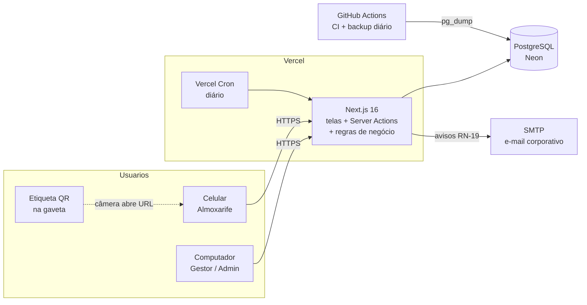
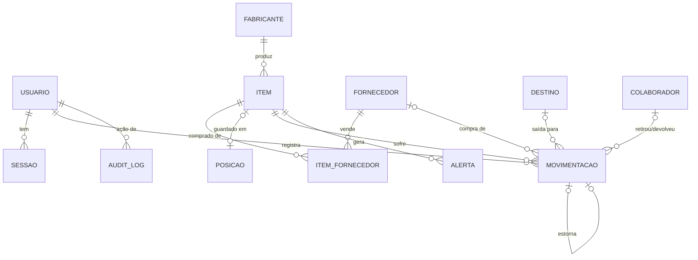
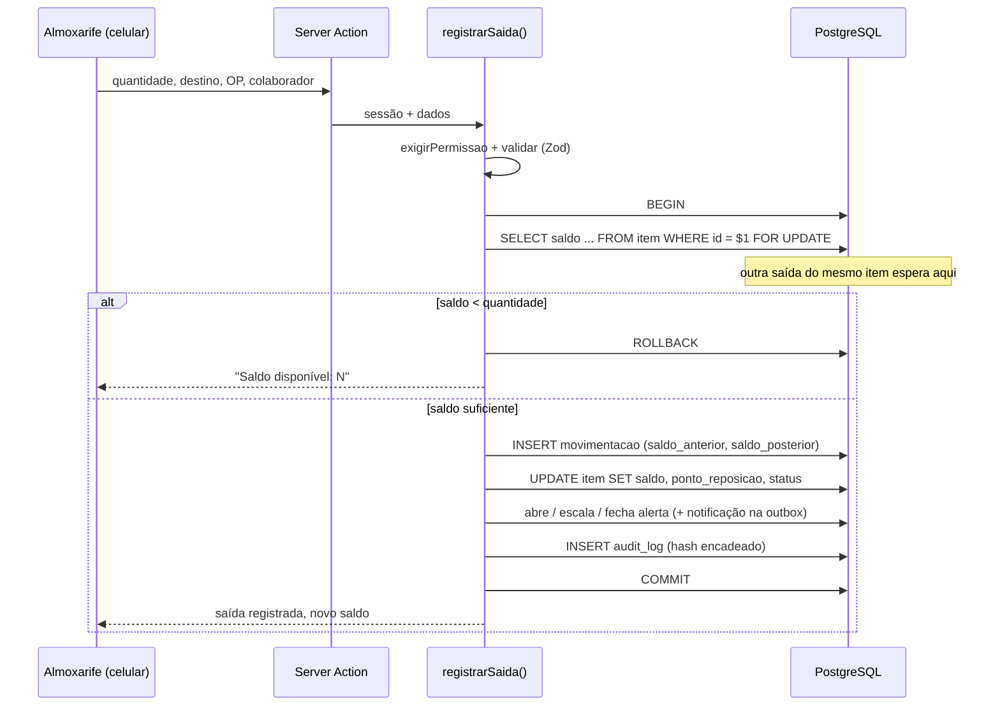

# SIMI: System Design

| | |
|---|---|
| **Projeto** | SIMI, controle de estoque de pastilhas industriais |
| **Documento** | 03, System Design e Stack |
| **Versão** | 1.1 (para revisão) |
| **Base** | [01, Regras de Negócio](01-regras-de-negocio.md) · [02, Requisitos](02-requisitos.md) |

Este documento explica **como** o SIMI vai ser construído para cumprir as regras e os requisitos. Cada decisão aponta para a regra ou o requisito que ela atende. As decisões principais estão resumidas como ADRs na seção 10.

## 1. Visão geral

O SIMI é uma aplicação web responsiva, usada no computador do escritório e no celular do almoxarife. É um **monólito modular**: um único projeto Next.js serve as telas e executa as regras de negócio no servidor, com um banco PostgreSQL por trás.

Com 10 a 30 usuários e alguns milhares de itens, não há motivo para separar front e back, usar microsserviços ou filas externas. Um projeto só é mais barato de hospedar, mais fácil de testar e mais simples de manter, que é o que pede o RNF-07.



## 2. Stack

Versões conferidas em setembro de 2026, sempre na última versão estável.

| Camada | Escolha | Por quê |
|---|---|---|
| Linguagem | **TypeScript** (modo `strict`) | Uma linguagem no projeto todo. Os tipos pegam erros antes de rodar. |
| Framework | **Next.js 16** (App Router) + **React 19** | Telas e servidor no mesmo projeto. Server Components buscam dados direto no servidor e Server Actions recebem os formulários, então não é preciso manter uma API REST (que ficou fora do escopo). |
| Banco | **PostgreSQL 16+** | Transações ACID, `SELECT … FOR UPDATE`, `CHECK`, triggers e índices parciais, tudo usado nas regras críticas. |
| ORM | **Prisma ORM 7** com `@prisma/adapter-pg` e `prisma.config.ts` | Modelo tipado e migrations versionadas. O SQL puro (`$queryRaw`) entra nos pontos em que o ORM não alcança: lock de linha, triggers e permissões do banco. |
| Autenticação | **Sessão própria guardada no banco** + **Argon2id** (`@node-rs/argon2`) | O login não usa e-mail, e o sistema precisa derrubar sessões na hora em que alguém é inativado (RN-21b). Uma sessão em tabela resolve os dois com pouco código. |
| Validação | **Zod 4** | O mesmo schema valida o formulário no navegador e os dados no servidor. |
| Interface | **Tailwind CSS 4** + **shadcn/ui** + react-hook-form + TanStack Table | Componentes acessíveis, responsivos e sem licença. |
| Gráficos | **Recharts** | Gráficos do painel (RF-16). |
| QR | **qrcode** | Gera o QR das etiquetas no servidor (RF-22). |
| CSV | **Papa Parse** | Leitura da planilha na importação (RF-25) e geração dos CSV exportados (RF-20). |
| PDF | Página de impressão com CSS `@media print` | Relatórios e etiquetas saem pelo "Imprimir → Salvar como PDF" do navegador, sem biblioteca nem serviço extra. |
| E-mail | **Nodemailer** (SMTP) | Funciona com qualquer e-mail corporativo. No desenvolvimento, o **Mailpit** captura os e-mails localmente. |
| Logs técnicos | **pino** (JSON) | Logs estruturados de erro e acesso (RNF-11), separados do log de auditoria. |
| Testes | **Vitest 5** (unidade e integração, com repórter HTML e Vitest UI) + **Playwright** (ponta a ponta) | Ver seção 9. Os testes das regras também rodam no navegador do avaliador (seção 9.3). |
| Qualidade | ESLint, Prettier, `tsc --noEmit`, GitHub Actions | Rodam em todo push. |
| Hospedagem | **Vercel** (plano Hobby) + **Neon** (PostgreSQL, plano Free) | Custo zero para um projeto acadêmico. |
| Execução local | **Docker Compose** (app, PostgreSQL, Mailpit) | Sobe o sistema inteiro com um comando, para desenvolver ou apresentar sem internet. |

## 3. Arquitetura em camadas

```
src/
├── app/                    rotas e telas (App Router)
│   ├── (publico)/login
│   ├── (app)/painel, itens, movimentacoes, relatorios, alertas
│   ├── (app)/cadastros/    fabricantes, fornecedores, destinos, colaboradores, posicoes
│   ├── (app)/admin/        usuarios, parametros, auditoria, importacao
│   ├── p/[codigo]/         destino do QR: resolve a posição e abre o item
│   ├── testes/             Laboratório de testes público (seção 9.3)
│   └── api/cron/           rotina diária (protegida por segredo)
├── components/             componentes de interface
├── domain/                 regras puras, sem banco e sem framework
│   ├── estoque.ts          consumo médio, ponto de reposição, status, sugestão (RN-15 a RN-20)
│   ├── movimentacao.ts     decisões de entrada, saída e estorno (RN-08, RN-10 a RN-13)
│   ├── alertas.ts          abrir / escalar / fechar alerta (RN-18, RN-19)
│   ├── precos.ts           último preço e histórico por fornecedor (RN-05a, RN-05b)
│   ├── posicao.ts          endereçamento (RN-25)
│   ├── auditoria.ts        hash encadeado e verificação (RN-09a)
│   ├── *.casos.ts          casos de teste como dados, usados pelo Vitest e pelo Laboratório
│   ├── login.ts            geração de login a partir do nome (RN-21)
│   ├── senha.ts            política de senha e geração da provisória (RN-21, RN-22)
│   ├── cnpj.ts             validação de CNPJ (RN-04)
│   ├── permissoes.ts       matriz perfil × permissão (doc 02, seção 5)
│   └── schemas/            schemas Zod de cada formulário
├── server/
│   ├── services/           casos de uso: registrarSaida, estornar, criarUsuario...
│   ├── repositories/       consultas ao banco
│   ├── auth/               sessão, hash de senha, bloqueio, rate limit
│   ├── audit/              gravação e verificação do log encadeado
│   ├── notificacao/        outbox de e-mail
│   └── db.ts               Prisma Client
├── proxy.ts                cabeçalhos de segurança e redirecionamento de quem não está logado
prisma/
├── schema.prisma
├── migrations/             inclui SQL de triggers, CHECKs e permissões
└── seed.ts                 Administrador inicial e parâmetros padrão
tests/
├── unit/  integration/  e2e/
```

**Regras de dependência:**

1. `domain/` não importa nada de `server/` nem de `app/`. São funções puras, fáceis de testar, e é onde ficam as fórmulas do documento 01.
2. As telas **nunca** acessam o banco diretamente. Leitura passa por `repositories/`, escrita passa por `services/`.
3. Todo service de escrita segue a mesma sequência:
   1. `exigirPermissao(usuario, 'movimentacao:saida')`, que confere o perfil no servidor (RNF-05);
   2. validação da entrada com Zod;
   3. abertura da transação;
   4. regra de negócio;
   5. gravação;
   6. registro no log de auditoria, dentro da mesma transação;
   7. commit.

   Se qualquer passo falhar, nada é gravado.
4. As Server Actions são finas: recebem o formulário, chamam o service e devolvem o resultado para a tela.

Seguindo o guia de segurança do Next.js, cada Server Action confere a sessão de novo, mesmo que a página já tenha conferido, porque toda Action é uma porta de entrada independente.

## 4. Modelo de dados



### Tabelas

| Tabela | Campos principais | Restrições importantes |
|---|---|---|
| `usuario` | id, nome, sobrenome, login, setor, perfil, ativo, deve_trocar_senha, senha_hash, falhas_login, bloqueado_em | `login` único e nunca reaproveitado |
| `historico_senha` | usuario_id, senha_hash, criado_em | guarda as 3 últimas (RN-22) |
| `sessao` | id (hash SHA-256 do token), usuario_id, expira_em, ultimo_uso, ip, user_agent | apagada no logout e na inativação |
| `tentativa_login` | ip, login_informado, sucesso, criado_em | usada no rate limit por IP |
| `fabricante` | id, nome, ativo | `lower(nome)` único |
| `fornecedor` | id, razao_social, nome_fantasia, cnpj, telefone, contato, ativo | `cnpj` único |
| `item` | id, codigo, descricao, iso, classe, cobertura, aplicacao, fabricante_id, embalagem, estoque_minimo, estoque_maximo, **saldo**, **ponto_reposicao**, **status**, ativo | `codigo` único; `CHECK (saldo >= 0)`; `CHECK (estoque_maximo IS NULL OR estoque_maximo > estoque_minimo)` |
| `item_fornecedor` | item_id, fornecedor_id, codigo_no_fornecedor, lead_time_dias, preferencial, ultimo_preco, data_ultima_compra | PK (item_id, fornecedor_id); índice único parcial para um preferencial por item |
| `posicao` | id, armario, gaveta, compartimento, codigo, item_id, ativo | `codigo` único (`A01-G03-C04`); `item_id` único quando preenchido |
| `destino` | id, tipo, codigo, nome, ativo | `codigo` único |
| `colaborador` | id, nome, matricula, setor, ativo | `matricula` única quando preenchida |
| `movimentacao` | id, item_id, tipo, quantidade, saldo_anterior, saldo_posterior, fornecedor_id, preco_unitario, nota_fiscal, destino_id, ordem_producao, colaborador_id, motivo, estorna_id, usuario_id, ip, user_agent, criado_em | `CHECK (quantidade > 0)`; `estorna_id` único; `CHECK`s por tipo (ex.: `COMPRA` exige fornecedor, preço e NF); **sem UPDATE nem DELETE** |
| `alerta` | id, item_id, nivel, aberto_em, fechado_em, ciente_por, ciente_em | índice único parcial `(item_id) WHERE fechado_em IS NULL` |
| `notificacao` | id, alerta_id, nivel, destinatario, status, tentativas, erro, criado_em, enviado_em | outbox de e-mail |
| `audit_log` | seq, acao, entidade, entidade_id, antes, depois (JSONB), usuario_id, ip, user_agent, criado_em, prev_hash, hash | **sem UPDATE nem DELETE** |
| `parametro` | chave, valor | janela de consumo, tempo de sessão, e-mail de aviso |

Algumas decisões do modelo:

- **IDs** são UUID v7, que são únicos e crescem com o tempo, o que ajuda nos índices. O `audit_log` usa uma sequência numérica (`seq`), porque a cadeia de hash precisa de uma ordem sem ambiguidade.
- **Datas** são `timestamptz`, gravadas em UTC e exibidas no fuso America/Sao_Paulo. A hora sempre vem do banco (`now()`), nunca do aparelho (RN-09).
- **O histórico de preços não tem tabela própria.** Ele é a lista das movimentações `COMPRA` de cada item + fornecedor. O `ultimo_preco` em `item_fornecedor` é só um atalho, recalculado a cada compra ou estorno de compra (RN-05a).
- **O saldo fica guardado em `item.saldo`**, atualizado na mesma transação da movimentação. Somar um milhão de linhas a cada consulta seria lento (RNF-03). A soma das movimentações continua sendo a fonte da verdade, e a conferência da RN-09b compara as duas.
- **`ponto_reposicao` e `status` também ficam guardados**, recalculados a cada movimentação do item e pela rotina diária.
- **Preços** são `numeric(12,2)`, nunca ponto flutuante.
- **Índices** para os filtros de histórico e relatórios: `movimentacao (item_id, criado_em)`, `(tipo, criado_em)`, `(destino_id, criado_em)`, `(colaborador_id, criado_em)` e `(ordem_producao)`.

## 5. Fluxos críticos

### 5.1 Saída sem saldo negativo (RN-08)

Duas pessoas podem tentar tirar o mesmo item no mesmo segundo. O lock de linha faz a segunda esperar a primeira terminar e só então conferir o saldo.



O `CHECK (saldo >= 0)` fica como última defesa: mesmo que um bug passe pelo código, o banco recusa o saldo negativo. As entradas, os ajustes e os estornos usam o mesmo caminho, com o mesmo lock.

### 5.2 Log que não pode ser alterado (RN-09a)

Três camadas de proteção:

1. **Permissão no banco.** A aplicação se conecta com um usuário (`simi_app`) que só tem `SELECT` e `INSERT` em `movimentacao` e `audit_log`. Mesmo que alguém invada a aplicação, não consegue alterar o histórico. As migrations rodam com outro usuário (`simi_owner`).
2. **Trigger.** `BEFORE UPDATE OR DELETE` nessas duas tabelas dispara um erro, o que protege também contra engano de quem tem acesso de dono.
3. **Cadeia de hash.** Cada registro do `audit_log` guarda:

   ```
   hash = SHA-256( prev_hash || seq || JSON canônico do registro )
   ```

   O primeiro registro usa um `prev_hash` de 64 zeros. Para dois registros não disputarem o mesmo "anterior", a gravação pega um lock de transação (`pg_advisory_xact_lock`), o que não pesa com 30 usuários. Cada movimentação gera um registro de auditoria com todos os seus campos.

A **verificação de integridade** (RF-21) percorre o `audit_log` em ordem, recalcula cada hash e aponta o primeiro `seq` em que a conta não fecha. Em seguida compara cada linha de `movimentacao` com o registro de auditoria correspondente. Assim, se alguém desligar o trigger e alterar uma movimentação direto no banco, a diferença aparece.

A **conferência de saldo** (RN-09b) compara `item.saldo` com a soma das movimentações de cada item e lista as divergências.

### 5.3 Estorno (RN-12)

- A coluna `estorna_id` é única, então o banco impede dois estornos da mesma movimentação.
- O service recusa o estorno de um estorno.
- O estorno lança o efeito contrário pelo mesmo caminho do 5.1, com lock e checagem de saldo. É isso que barra o estorno de uma entrada cujo saldo já foi consumido.
- Se a movimentação estornada for uma `COMPRA`, o `ultimo_preco` do fornecedor volta para o da compra válida anterior.

### 5.4 Alertas e e-mail (RN-17 a RN-19)

- O status é recalculado dentro da transação de cada movimentação, com as funções de `domain/estoque.ts`.
- O índice único parcial em `alerta` garante que nunca existam dois alertas abertos para o mesmo item, mesmo com gravações simultâneas.
- **Outbox de e-mail.** Quando o alerta chega a `CRITICO` ou `ZERADO`, a transação grava uma linha em `notificacao` com status `PENDENTE`. Depois do commit, o sistema tenta enviar o e-mail e marca `ENVIADO` ou `FALHOU`. Uma falha de e-mail nunca desfaz a movimentação (RF-14), e a rotina diária tenta de novo os envios que falharam.
- **Rotina diária** (Vercel Cron, de madrugada): a janela de consumo médio anda com o tempo, então o ponto de reposição muda mesmo sem movimentação. A rotina recalcula `ponto_reposicao` e `status` de todos os itens ativos, abre ou fecha alertas e reenvia as notificações pendentes. A rota `/api/cron/diario` só aceita chamadas com o segredo `CRON_SECRET`.

### 5.5 Login, sessão e criação de usuário (RN-21, RN-22)

**Criação de usuário:**
- `domain/login.ts` gera o login: tira acentos, passa para minúsculas, descarta as partículas "de", "da", "do", "dos" e "das" e junta o primeiro nome com o último sobrenome.
- O service procura logins existentes com o mesmo prefixo, incluindo os inativos, e acrescenta o próximo número livre.
- A senha provisória sai de `crypto.randomInt` sobre um alfabeto sem caracteres ambíguos.
- Só o hash Argon2id vai para o banco. A senha em texto volta uma única vez para a tela do Administrador e não é registrada em log nenhum.

**Login:**
- Confere o bloqueio e o limite de tentativas por IP (20 a cada 15 minutos) e depois verifica a senha.
- Se falhar, incrementa `falhas_login`. Na quinta falha seguida, a conta é bloqueada.
- A mensagem de erro é sempre a mesma: "login ou senha inválidos".

**Sessão:**
- Token aleatório de 32 bytes no cookie `simi_sessao`, com `HttpOnly`, `Secure`, `SameSite=Lax` e `Path=/`. O banco guarda só o SHA-256 do token: se a tabela vazar, os tokens não servem para nada.
- Expira por inatividade (parâmetro, padrão 30 minutos) e tem duração máxima de 12 horas.
- **Troca de senha obrigatória:** enquanto `deve_trocar_senha` for verdadeiro, qualquer rota redireciona para `/trocar-senha`.
- **Inativação (RN-21b):** o service apaga todas as sessões do usuário na mesma transação, e a próxima requisição dele já cai no login.
- O `proxy.ts` do Next.js 16 só faz a checagem rápida (existe cookie? se não, vai para o login). A validação de verdade acontece no servidor, a cada página e a cada Action.

**Seed:** a instalação cria o usuário `admin` com uma senha provisória mostrada no terminal e `deve_trocar_senha = true`.

### 5.6 QR das posições (RN-26)

- O QR guarda a URL `https://<domínio>/p/A01-G03-C04`, com o código da **posição**, não do item. A rota procura o item que está naquela posição e abre a página dele.
- Se a posição estiver vazia, a rota mostra isso.
- Sem login, a rota leva ao login e volta para o item depois. O redirecionamento só aceita caminhos internos, para evitar open redirect.
- A página de etiquetas monta uma grade A4 com QR, código da posição, código interno e descrição, pronta para imprimir.

### 5.7 Importação inicial (RF-25)

O Administrador baixa um modelo de CSV, preenche e envia. O sistema:

1. lê o arquivo com Papa Parse e valida cada linha com Zod;
2. mostra uma prévia com os erros linha a linha, sem gravar nada;
3. na confirmação, grava tudo numa única transação: itens, vínculos com fornecedores, posições e um `AJUSTE_POSITIVO` com a justificativa "saldo inicial da implantação" para cada saldo.

Se qualquer linha falhar na gravação, nada é gravado.

## 6. Segurança

Mapa das categorias do OWASP Top 10 (2021) para as proteções do SIMI. A revisão completa fica para o documento 04.

| Risco | Como o SIMI se protege |
|---|---|
| A01 Controle de acesso quebrado | Matriz de permissões em `domain/permissoes.ts`, conferida em todo service no servidor. A tela esconder um botão não conta como proteção. Testes de integração tentam cada ação com cada perfil. |
| A02 Falhas de criptografia | HTTPS obrigatório com HSTS. Senhas com Argon2id. Tokens de sessão guardados só como hash. |
| A03 Injeção | Prisma parametriza as consultas. O SQL manual usa só template com parâmetros (`$queryRaw`\`...${x}\``), nunca concatenação. Toda entrada passa pelo Zod. |
| A04 Design inseguro | Regras críticas garantidas também no banco (`CHECK`, índices únicos, triggers), não só no código. |
| A05 Configuração insegura | Cabeçalhos definidos no `proxy.ts`: CSP com nonce, `frame-ancestors 'none'`, `X-Content-Type-Options`, `Referrer-Policy`. Mensagens de erro genéricas em produção. |
| A06 Componentes vulneráveis | `npm audit` e Dependabot no GitHub. |
| A07 Falhas de autenticação | Bloqueio após 5 falhas, rate limit por IP, política de senha, expiração de sessão, troca obrigatória da provisória. |
| A08 Integridade de dados | Log inalterável com cadeia de hash, lockfile versionado. |
| A09 Falhas de log e monitoramento | Log de auditoria (negócio) + pino (técnico). Tentativas de login com falha ficam registradas. |
| A10 SSRF | O sistema não busca URLs informadas pelo usuário. |
| CSRF | As Server Actions do Next.js só aceitam requisições da mesma origem, e o cookie é `SameSite=Lax`. |

**Segredos** (`DATABASE_URL`, `CRON_SECRET`, credenciais SMTP) ficam em variáveis de ambiente. O repositório tem só o `.env.example`, sem valores reais.

**LGPD (RNF-06):** o sistema guarda apenas nome, sobrenome, setor e login dos usuários, e nome, setor e matrícula dos colaboradores. Nenhum e-mail pessoal. A finalidade é identificar quem fez cada movimentação.

## 7. Ambientes, deploy e backup

| Ambiente | Onde | Uso |
|---|---|---|
| Local | `docker compose up`: app, PostgreSQL 16 e Mailpit | Desenvolvimento e apresentação sem internet |
| Teste | PostgreSQL como serviço no GitHub Actions | Testes de integração e E2E na CI |
| Produção (demonstração) | Vercel Hobby + Neon Free | Acesso pelo celular durante a apresentação |

**Conexão com o Neon:** a aplicação usa a URL com pooling (`DATABASE_URL`) e as migrations usam a URL direta (`DIRECT_URL`), configurada no `prisma.config.ts`. O lock de linha e o `pg_advisory_xact_lock` valem só dentro da transação, então funcionam com o pooling do Neon.

**Backup (RNF-04):**
- Um workflow agendado no GitHub Actions roda `pg_dump` todo dia e guarda o arquivo como artifact por 30 dias.
- O dump tem dados pessoais, então o repositório precisa ser **privado**.
- O procedimento de restauração vai documentado no README e é testado pelo menos uma vez antes da apresentação.
- O Neon ainda oferece restauração de um ponto no tempo dentro da janela do plano gratuito.

**Custo (RNF-07):**

| Item | Custo mensal |
|---|---|
| Vercel Hobby | R$ 0 |
| Neon Free (0,5 GB, suficiente para anos de movimentação nesse volume) | R$ 0 |
| GitHub (repositório privado, Actions, artifacts) | R$ 0 |
| SMTP (e-mail corporativo existente ou plano gratuito de um provedor) | R$ 0 |
| **Total** | **R$ 0** |

Numa implantação real na empresa, dá para trocar por um servidor local com Docker Compose, ou pelos planos pagos de entrada (Vercel Pro e Neon Launch), e continuar abaixo do teto de R$ 100 por mês.

## 8. Desempenho e retenção (RNF-03, RNF-12)

- Com 30 usuários e cerca de 200 movimentações por dia, 7 anos dão por volta de 500 mil linhas em `movimentacao`, abaixo do limite de 1 milhão previsto no RNF-03.
- As listas de itens leem `item.saldo` e `item.status` direto, sem somar movimentações.
- Histórico e relatórios usam os índices da seção 4 e sempre filtram por período, com paginação no servidor.
- A consulta do consumo médio pega só a janela de N dias de um item, usando o índice `(item_id, criado_em)`.
- Não é preciso particionar tabelas nesse volume. Se um dia for, o PostgreSQL permite particionar `movimentacao` por ano sem mudar a aplicação.

## 9. Estratégia de testes

### 9.1 Regra geral: teste unitário em tudo o que for possível

Todo código que dá para testar isolado tem teste unitário, e código novo só entra junto com os testes dele (RNF-08). Para isso funcionar, a arquitetura tira do banco e do framework toda decisão que puder ser tirada. Os services só abrem a transação, buscam os dados e gravam o resultado. A decisão em si ("essa saída pode ser feita?", "esse estorno é permitido?", "o alerta sobe de nível?") fica numa função pura em `domain/`, que se testa sem banco.

| Parte do sistema | Tem teste unitário? | O que é testado | Aparece no Laboratório (9.3)? |
|---|---|---|---|
| `domain/estoque.ts` | Sim | Consumo médio, ponto de reposição, status, sugestão de compra, conversão de caixas em unidades (RN-07, RN-15 a RN-17, RN-20) | Sim |
| `domain/movimentacao.ts` | Sim | Se uma saída, entrada ou estorno pode ser feito e qual o saldo resultante (RN-08, RN-10 a RN-13) | Sim |
| `domain/alertas.ts` | Sim | Abrir, escalar ou fechar alerta e quando mandar e-mail (RN-18, RN-19) | Sim |
| `domain/precos.ts` | Sim | Último preço por fornecedor, ordenação, variação entre compras, efeito do estorno (RN-05a, RN-05b) | Sim |
| `domain/login.ts` e `domain/senha.ts` | Sim | Geração de login, sufixo numérico, política de senha, senha provisória sem caracteres ambíguos (RN-21, RN-22) | Sim |
| `domain/cnpj.ts` | Sim | Dígitos verificadores (RN-04) | Sim |
| `domain/posicao.ts` | Sim | Código `A01-G03-C04`, posição ocupada, troca de posição (RN-25) | Sim |
| `domain/permissoes.ts` | Sim | Cada perfil × cada ação da matriz do documento 02 | Sim |
| `domain/auditoria.ts` | Sim | Hash encadeado e verificação da cadeia (RN-09a) | Sim, com demonstração de adulteração |
| `domain/schemas/` (Zod) | Sim | Campos obrigatórios por tipo de movimentação, formatos, limites (RN-10, RN-11) | Sim |
| `domain/importacao.ts` | Sim | Validação linha a linha do CSV (RF-25) | Não, só no relatório |
| Componentes de interface | Sim, com Testing Library | Selo de status com texto e cor (RNF-10), formulário de saída exigindo os campos, tabela de fornecedores escondendo preço do perfil Consulta | Não, só no relatório |
| `server/services/` | Em parte | A parte de decisão já está coberta pelo `domain/`. O que depende do banco vai para a integração | Não |
| Lock de linha, triggers, permissões do banco, sessão, e-mail | Não é possível em unidade | Dependem do PostgreSQL ou da rede: cobertos por integração e E2E | Não |

### 9.2 Níveis de teste

| Nível | Ferramenta | O que cobre | Meta |
|---|---|---|---|
| Unidade | Vitest 5 (+ Testing Library para componentes) | Tudo da tabela 9.1 marcado com "Sim". Os exemplos numéricos do documento 01 viram testes. | Toda RN com pelo menos um teste; ≥ 90% de cobertura de linhas em `domain/` |
| Integração | Vitest + PostgreSQL real | Services com banco de verdade: saídas concorrentes (RN-08), estorno duplo (RN-12), trigger de imutabilidade e detecção de adulteração no banco (RN-09a), alerta único por item (RN-18), inativação derrubando sessões (RN-21b), cada ação testada com cada perfil | Todos os critérios de aceite do documento 02 com regra no servidor |
| Ponta a ponta | Playwright | Primeiro acesso com troca de senha; criar usuário; entrada; saída pelo celular (viewport 360 px) a partir da URL do QR; estorno; alerta no painel; relatório de reposição | Fluxos principais do MVP |
| Estático | ESLint, `tsc`, Prettier | Estilo e tipos | Sem erros |

**CI (GitHub Actions)**, em todo push e pull request: instalar, rodar lint, typecheck, testes de unidade e integração (PostgreSQL como serviço), build, e2e. Só entra na branch principal o que passar.

### 9.3 Laboratório de testes para o avaliador (RNF-13)

O professor precisa ver os testes, rodar os testes e **testar por conta própria**, sem instalar nada. Para isso o SIMI tem uma página pública em `https://<domínio-do-simi>/testes`, com três abas.

**Aba 1: Executar os testes.**
- Mostra os testes das regras de negócio agrupados por regra (RN-15, RN-21...), cada um com a descrição em português.
- O botão **"Executar todos"** roda os testes no próprio navegador do professor, chamando as mesmas funções de `domain/` que o sistema usa. Cada teste fica verde ou vermelho, com o valor esperado e o obtido.
- Também dá para rodar um grupo só ou um teste só.

**Aba 2: Criar o seu teste.**
Para cada regra, um formulário onde o professor escolhe as entradas e diz qual resultado espera. Ao clicar em **"Testar"**, a página calcula com a função real, compara com o esperado e explica a conta. Por exemplo:

| Regra | O professor informa | O sistema responde |
|---|---|---|
| RN-15 Ponto de reposição | mínimo, consumo diário, lead time, resultado esperado | valor calculado, a fórmula com os números e ✔ ou ✘ |
| RN-17 Status | saldo, mínimo, ponto de reposição | `OK`, `ATENCAO`, `CRITICO` ou `ZERADO` |
| RN-20 Sugestão de compra | saldo, ponto de reposição, máximo, consumo, embalagem | quantidade sugerida, arredondada em caixas |
| RN-08 Saída | saldo atual e quantidade pedida | aceita (novo saldo) ou recusada ("saldo disponível: N") |
| RN-12 Estorno | tipo da movimentação, se já foi estornada, saldo atual | permitido ou recusado, com o motivo |
| RN-21 Geração de login | nome, sobrenome e logins já existentes | login gerado (ex.: `maria.souza2`) |
| RN-22 Política de senha | uma senha, o login e as últimas senhas | aceita ou recusada, com o motivo |
| RN-04 CNPJ | um CNPJ | válido ou inválido |
| Permissões | perfil e ação | permitido ou negado |
| RN-10 / RN-11 Formulários | tipo de movimentação e campos preenchidos | quais campos faltam |

Os casos criados ficam guardados só no navegador do professor e podem ser rodados de novo junto com os oficiais.

**Aba 3: Demonstração do log inalterável (RN-09a).** Mostra uma pequena cadeia de registros de auditoria de exemplo. O professor edita qualquer valor (troca uma quantidade de 4 para 40, por exemplo) e clica em **"Verificar integridade"**. A página recalcula os hashes e aponta o registro exato em que a cadeia quebrou. É a mesma função que o sistema usa na verificação real.

**Relatório completo.** Um link na página abre o relatório HTML do Vitest da suíte inteira de unidade (incluindo componentes e importação), com a cobertura. Ele é gerado no build: se qualquer teste falhar, o build falha e a versão nova não vai para o ar.

**Como os mesmos testes rodam nos dois lugares.** Os casos de teste são escritos como dados, em arquivos `*.casos.ts` ao lado de cada módulo. O Vitest usa esses arquivos com `it.each`, e o Laboratório importa os mesmos arquivos para rodar no navegador. O que o professor executa é exatamente o que a CI executa:

```ts
// src/domain/estoque.casos.ts
export const casosPontoReposicao = [
  { descricao: 'exemplo do doc 01: mínimo 20, consumo 3/dia, lead time 7',
    entrada: { minimo: 20, consumoDiario: 3, leadTime: 7 }, esperado: 41 },
  { descricao: 'sem consumo registrado, vale o mínimo',
    entrada: { minimo: 20, consumoDiario: 0, leadTime: 7 }, esperado: 20 },
]

// src/domain/estoque.test.ts
describe('RN-15 · Ponto de reposição', () => {
  it.each(casosPontoReposicao)('$descricao', ({ entrada, esperado }) => {
    expect(pontoDeReposicao(entrada)).toBe(esperado)
  })
})
```

Para que isso seja possível, `domain/` só usa recursos que existem tanto no Node quanto no navegador. O SHA-256 da cadeia de hash, por exemplo, usa a Web Crypto (`crypto.subtle`).

**Segurança da página.** O Laboratório roda só funções puras, no navegador. Ele não acessa o banco, não chama Server Actions e não mostra dados do estoque, então pode ficar aberto sem login.

**Na apresentação.** Além da página, o `npm run test:ui` abre o Vitest UI para rodar a suíte inteira ao vivo e mostrar o código de cada teste.

O README também exibe o selo da CI do GitHub Actions, que mostra se a última versão passou em todos os testes.

## 10. Decisões de arquitetura (ADRs)

| ADR | Decisão | Alternativa descartada | Motivo |
|---|---|---|---|
| 01 | Monólito modular em Next.js | Front e back separados (React + API) | Um projeto só é mais barato e mais simples para 30 usuários. Sem API pública, porque a integração ficou fora do escopo. |
| 02 | PostgreSQL | MySQL, MongoDB | Lock de linha, CHECK, triggers e índices parciais resolvem no banco as regras mais sensíveis. |
| 03 | Sessão própria em banco | Auth.js, JWT | Login sem e-mail, revogação imediata (RN-21b) e pouco código. JWT não dá para revogar na hora. |
| 04 | Saldo guardado no item + lock pessimista (`FOR UPDATE`) | Calcular o saldo sempre pela soma; lock otimista | Leitura rápida (RNF-03) e nenhuma chance de saldo negativo (RN-08). A soma continua disponível para a conferência. |
| 05 | Log com cadeia de hash + trigger + permissão restrita no banco | Só um log comum | Torna qualquer adulteração detectável (RN-09a). |
| 06 | Outbox para e-mail | Enviar dentro da transação | E-mail fora do ar não trava a movimentação. |
| 07 | QR aponta para a posição | QR aponta para o item | A etiqueta fica presa na gaveta. Apontando para a posição, o QR continua levando ao item certo mesmo depois de uma troca. |
| 08 | PDF pela impressão do navegador | Biblioteca de geração de PDF | Atende o RF-20 sem dependência extra. |
| 09 | Vercel + Neon, com Docker Compose como alternativa | VPS paga | Custo zero para o trabalho, com um plano B que roda sem internet. |
| 10 | Laboratório de testes em `/testes`: testes rodando no navegador do avaliador + relatório do Vitest gerado no build | Só um relatório estático; GitHub Pages; só a aba Actions do GitHub | O avaliador executa e cria testes sem instalar nada, no mesmo endereço do sistema. E o build só publica o que passou nos testes. |
| 11 | Casos de teste escritos como dados (`*.casos.ts`) e decisões extraídas para funções puras | Testes só no formato tradicional; lógica dentro dos services | Os mesmos casos rodam na CI e no navegador, e quase todo o sistema fica testável em unidade. |

## 11. Histórico do documento

| Versão | Data | Mudança |
|---|---|---|
| 1.0 | 25/09/2026 | Primeira versão: stack, arquitetura, modelo de dados, fluxos críticos, segurança, deploy e testes. |
| 1.1 | 26/09/2026 | Testes unitários em todo o sistema (9.1) e Laboratório de testes para o avaliador executar e criar testes na web (9.3, ADR-10 e ADR-11). |
